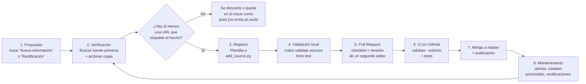

# Flujo de Incorporación de Información Nueva

Este documento define cómo entra información al vault y cómo se mantiene. La regla base es simple: **sin fuente verificable no hay nota publicada**. Cada afirmación sobre una persona o entidad debe poder rastrearse hasta una URL pública que cualquier lector pueda abrir.



## 1. Principios Editoriales
1. **Fuente o nada.** Causas (`02_Causas/`) y evidencias (`04_Evidencias/`) requieren al menos una entrada en `fuentes:` con URL. Un nexo `TRX` hereda la cobertura de su `evidencia_soporte`.
2. **Imputaciones con respaldo reforzado.** Si una nota atribuye un delito, una formalización o una condena a una persona natural, debe tener **una fuente primaria** (resolución, sentencia, comunicado oficial) **o dos fuentes secundarias independientes**.
3. **Presunción de inocencia.** El campo `situacion_procesal` refleja exactamente lo que dicen las fuentes (`formalizado` no es `condenado`). Las absoluciones y sobreseimientos se registran con la misma visibilidad que las acusaciones.
4. **Privacidad y víctimas.** No se incorporan hechos de la vida íntima, de salud o familiares ajenos al eje de corrupción, aunque hayan salido en prensa. Las víctimas no se modelan como actores de un nexo.
5. **Mención no es vínculo.** Aparecer en una filtración o desclasificación (Panama/Pandora Papers, archivos Epstein) no constituye un hecho ilícito. Si no hay investigación ni imputación en Chile, la información va a un anexo documental en `06_Anexos/`, fuera del grafo (ver sección 5).
6. **Sin datos personales.** No se publica el RUT, domicilio, teléfono ni datos de familia de personas naturales; el validador rechaza notas de persona con `rut`. Los RUT de empresas y organismos públicos sí se registran, con su fuente.
7. **Nada inventado.** RUC, RUT, roles, montos y fechas se copian del documento fuente. Si no se conoce un dato, se deja vacío; no se estima ni se completa con un valor plausible.

## 2. Jerarquía de Fuentes
| Nivel | Ejemplos | `tipo` |
| :--- | :--- | :--- |
| Documento oficial | Sentencias (pjud.cl, tdlc.cl), requerimientos FNE, informes CGR, resoluciones CMF/SVS, querellas SII/CDE, comunicados de Fiscalía, InfoLobby, Mercado Público, Transparencia Activa | `primaria` |
| Filtraciones curadas | ICIJ Offshore Leaks, desclasificaciones (NSA Archive, DOJ, CIA FOIA) | `primaria` |
| Periodismo de investigación y prensa | CIPER, BioBioChile, La Tercera, Emol, El Mostrador, Cooperativa, CNN Chile | `secundaria` |
| Academia | Revistas indexadas, centros de estudio (CentroCompetencia, UDD, UC) | `secundaria` |
| No admisibles como única fuente | Redes sociales, blogs sin autoría, foros, contenido generado por IA | — |

## 3. Paso a Paso

### Paso 1 — Proponer
Abre un *Issue* en GitHub con la plantilla **"Nueva información"** (hechos nuevos, causas, actualizaciones de estado procesal) o **"Rectificación"** (datos erróneos, absoluciones, solicitudes de retiro). Incluye siempre la URL de respaldo.

### Paso 2 — Verificar y archivar
1. Busca el documento primario detrás de la nota de prensa (número de rol/RIT/RUC, resolución exenta, ID de orden de compra).
2. Contrasta fechas, montos y nombres con lo que ya existe en el vault. Si hay diferencias, regístralas como `alertas_verificacion`.
3. Archiva la URL en [web.archive.org/save](https://web.archive.org/save) y anota la copia en el campo `archivo`. Los medios cambian o retiran URLs; la copia preserva la cadena de custodia.

### Paso 3 — Registrar
Decide primero dónde va: si hay una causa, una investigación o un hecho de interés público con fuente, entra al grafo (`02_Causas/`, `03_Hechos_y_Nexos/`, `04_Evidencias/`). Si es solo una mención en documentos, sin imputación, va a `06_Anexos/`.

**Nota nueva:** crea la nota desde la plantilla correspondiente en `00_Meta/Plantillas/` (`tpl_causa`, `tpl_evidencia`, `tpl_nexo_transaccion`, `tpl_persona`, `tpl_entidad_*`) con `Ctrl+P → Plantillas: Insertar plantilla`.

**Agregar una fuente a una nota existente:**
```bash
python3 00_Meta/Scripts/add_source.py --nota "Caso SQM" \
  --url "https://www.latercera.com/..." --titulo "Tribunal absuelve a los ocho acusados" \
  --medio "La Tercera" --tipo secundaria --fecha 2025-10-22 \
  --archivo "https://web.archive.org/web/..." --estado verificado
```

**Registrar una discrepancia** (sin cambiar el dato hasta que se revise):
```bash
python3 00_Meta/Scripts/add_source.py --nota "Caso SQM" \
  --alerta "El veredicto de oct-2025 absolvió a los acusados; actualizar estado_judicial."
```

**Cerrar una alerta ya atendida:**
```bash
python3 00_Meta/Scripts/add_source.py --nota "Caso SQM" --resolver-alerta "veredicto de oct-2025"
```

**Lotes desde portales de transparencia** (CSV/JSON con columnas `fuente_url`, `fuente_titulo`, `fuente_medio`, `fuente_tipo`, `fuente_fecha`):
```bash
python3 00_Meta/Scripts/ingest_osint.py --input transferencias.csv --dry-run
python3 00_Meta/Scripts/ingest_osint.py --input transferencias.csv
```
El ingestador nunca sobrescribe notas existentes y marca como `sin_fuente` las filas sin URL.

**Lotes de fuentes** (varias notas a la vez): `add_source.py --desde-yaml lote.yaml`, con el formato `{ruta_nota: {fuentes: [...], estado_verificacion: ..., alertas: [...], resueltas: [...]}}`.

### Paso 4 — Validar localmente
```bash
make validate   # YAML, Módulo 11, enlaces internos y esquema de fuentes
make sources    # regenera [[Cobertura_de_Fuentes]] (cobertura y alertas pendientes)
make links      # comprueba que cada URL responda
make screen     # triaje de riesgo de difamación con un modelo local (Ollama)
make test       # suite completa
```
`make screen` requiere [Ollama](https://ollama.com) con `qwen3:14b` (u otro modelo vía `--modelo`) y genera [[Revision_Riesgo_Difamacion]]. Es un filtro de triaje: el modelo puede equivocarse, así que cada hallazgo se contrasta con las fuentes antes de editar. Las frases que el modelo no copia literalmente se descartan.

`make validate-strict` es lo que corre el CI: falla si alguna causa o evidencia queda sin fuente.

### Paso 5 — Pull Request
Rama con nombre descriptivo (`fuentes/caso-sqm-veredicto`, `causa/caso-nuevo`). La plantilla de PR incluye la lista de verificación editorial. **Ningún cambio que afecte la `situacion_procesal` de una persona se fusiona sin la revisión de un segundo editor.**

### Paso 6 — CI
El workflow `.github/workflows/validar-vault.yml` ejecuta `validate_vault.py --estricto`, `check_sources.py` y la suite de tests en cada PR.

### Paso 7 — Publicación
El merge a `master` es la publicación. El visor web y las exportaciones (`make web`, `make export`) se regeneran después del merge.

### Paso 8 — Mantenimiento
- **Revisión mensual de estados procesales:** recorrer las causas con `estado_judicial` distinto de `cerrada*` y buscar novedades. `make links` detecta las URLs caídas.
- **Alertas:** [[Cobertura_de_Fuentes]] lista todas las `alertas_verificacion` pendientes. Cada alerta se resuelve corrigiendo el dato o documentando por qué se mantiene.
- **Rectificaciones:** un *Issue* de rectificación con respaldo documental se atiende antes que cualquier otro trabajo. Si la información resulta errónea, se corrige o retira la nota y el cambio queda registrado en el historial de git.

## 4. Criterios de `estado_verificacion`
| Estado | Cuándo usarlo | ¿Publicable? |
| :--- | :--- | :--- |
| `verificado` | Las fuentes respaldan el hecho tal como está descrito | Sí |
| `parcial` | Hay fuentes, pero algún dato (monto, fecha, rol, identificador) no está confirmado | Sí, con la alerta visible |
| `desactualizado` | Las fuentes muestran un estado procesal posterior al registrado | Corregir con prioridad |
| `sin_fuente` | No hay respaldo público | No: verificar o retirar |
| `pendiente` | Nota nueva sin revisión de un segundo editor | No |

## 5. Anexos Documentales Fuera del Grafo
Algunas informaciones son de interés público pero no corresponden a un hecho de corrupción, por ejemplo menciones de chilenos en archivos publicados en el extranjero sin investigación ni imputación en Chile. Como nodos del grafo quedarían conectadas con personas condenadas a través de los análisis de comunidades y vínculos, lo que sugiere culpa por asociación.

- **Qué va en un anexo:** menciones en filtraciones, desclasificaciones o expedientes extranjeros sin imputación en Chile, documentadas con sus fuentes.
- **Cómo se escribe:** `tipo_nodo: anexo_documental`, un aviso explícito de que aparecer no constituye delito y los nombres en texto plano, sin wikilinks a fichas de personas.
- **Qué hace el sistema:** los scripts de exportación y análisis no leen `06_Anexos/`; el validador sí lo revisa, así que el anexo debe tener sus fuentes.
- **Cuándo pasa al grafo:** si surge una investigación o imputación en Chile relacionada, se incorpora al grafo siguiendo este mismo flujo.
- **Ejemplo:** [[Menciones de Chilenos en Archivos Epstein]].

## 6. Lista de Verificación Rápida
- [ ] Cada causa/evidencia nueva tiene al menos una URL en `fuentes:`.
- [ ] Las imputaciones a personas tienen fuente primaria o dos secundarias independientes.
- [ ] `situacion_procesal` y `estado_judicial` coinciden con la fuente más reciente.
- [ ] RUC/RUT/roles/montos copiados del documento, no estimados.
- [ ] Copia archivada en `archivo`.
- [ ] Sin datos íntimos ni de víctimas.
- [ ] Las menciones sin imputación en Chile van a `06_Anexos/`, no al grafo.
- [ ] `make validate sources test` pasa sin errores.
