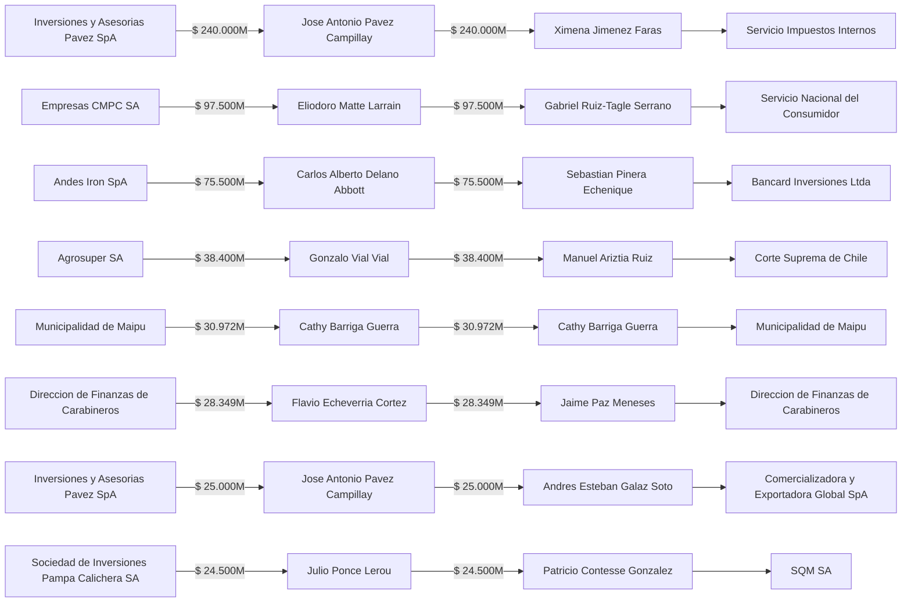

# 💰 Análisis de Flujo Financiero Máximo y Corte Mínimo (Edmonds-Karp)

> [!IMPORTANT] Teorema Max-Flow Min-Cut aplicado a Persecución Patrimonial y Comiso
> Esta vista modela el grafo dirigido de desembolsos como una **Red de Flujo Capacitada** ($S \rightarrow \text{Entidad Origen} \rightarrow \text{Firmante Origen} \rightarrow \text{Firmante Destino} \rightarrow \text{Entidad Destino} \rightarrow T$) y ejecuta el algoritmo de **Edmonds-Karp ($O(VE^2)$)** junto con optimización submodular de **Interdicción Patrimonial** para determinar el número mínimo de operadores cuyas cuentas/patrimonios deben ser objeto de medidas precautorias para interceptar el **100% del flujo financiero investigado**.

## 1. Métricas Globales de Flujo y Desigualdad Financiera

- **Flujo Máximo Auditado ($f^*$ de Edmonds-Karp)**: **`$750.998.563.198 CLP`** *(100% consistente con la suma de aristas `TRX` con flujo monetario)*
- **Capacidad del Corte Mínimo ($c(S, T)$)**: **`$750.998.563.198 CLP`** across `35` cuellos de botella primarios.
- **Coeficiente de Gini por Transacción (`TRX`)**: `0.7994`
- **Coeficiente de Gini por Causa Penal**: `0.7222`
- **Coeficiente de Gini por Operador / Firmante**: `0.7639`
- **Operadores requeridos para interceptar el 100% del flujo**: `30` personas (de un total de `68` firmantes con flujo monetario).

---

## 2. Curva de Interdicción Patrimonial Óptima (Medidas Precautorias / Comiso)

Orden óptimo de congelamiento de activos / medidas precautorias reales para maximizar el monto fiscal y corporativo interceptado en cada paso:

| Paso | Operador / Firmante Objetivo | TRX Interceptadas | Monto Marginal Interceptado | Monto Acumulado | % del Flujo Total |
| :---: | :--- | :---: | :---: | :---: | :---: |
| **1** | [[Jose Antonio Pavez Campillay]] | `2` | `$265.000.000.000 CLP` | `$265.000.000.000 CLP` | **`35.29%`** |
| **2** | [[Sebastian Pinera Echenique]] | `4` | `$107.550.000.000 CLP` | `$372.550.000.000 CLP` | **`49.61%`** |
| **3** | [[Eliodoro Matte Larrain]] | `1` | `$97.500.000.000 CLP` | `$470.050.000.000 CLP` | **`62.59%`** |
| **4** | [[Agustin Edwards Eastman]] | `3` | `$43.800.000.000 CLP` | `$513.850.000.000 CLP` | **`68.42%`** |
| **5** | [[Gonzalo Vial Vial]] | `1` | `$38.400.000.000 CLP` | `$552.250.000.000 CLP` | **`73.54%`** |
| **6** | [[Cathy Barriga Guerra]] | `1` | `$30.972.000.000 CLP` | `$583.222.000.000 CLP` | **`77.66%`** |
| **7** | [[Flavio Echeverria Cortez]] | `2` | `$29.798.928.198 CLP` | `$613.020.928.198 CLP` | **`81.63%`** |
| **8** | [[Patricio Contesse Gonzalez]] | `3` | `$25.570.000.000 CLP` | `$638.590.928.198 CLP` | **`85.03%`** |
| **9** | [[Augusto Pinochet Ugarte]] | `4` | `$24.650.000.000 CLP` | `$663.240.928.198 CLP` | **`88.31%`** |
| **10** | [[Marcelo Torres Ferrari]] | `2` | `$19.620.000.000 CLP` | `$682.860.928.198 CLP` | **`90.93%`** |
| **11** | [[Carlos Pavez Tolosa]] | `1` | `$14.200.000.000 CLP` | `$697.060.928.198 CLP` | **`92.82%`** |
| **12** | [[Sergio Munoz Gajardo]] | `4` | `$13.550.000.000 CLP` | `$710.610.928.198 CLP` | **`94.62%`** |
| **13** | [[Juan Miguel Fuente-Alba Poblete]] | `2` | `$9.600.000.000 CLP` | `$720.210.928.198 CLP` | **`95.90%`** |
| **14** | [[Felipe Sanchez Perez]] | `1` | `$8.200.000.000 CLP` | `$728.410.928.198 CLP` | **`96.99%`** |
| **15** | [[Jorge Zepeda Arancibia]] | `2` | `$5.300.000.000 CLP` | `$733.710.928.198 CLP` | **`97.70%`** |
| **16** | [[Alberto Larrain Salas]] | `3` | `$3.368.000.000 CLP` | `$737.078.928.198 CLP` | **`98.15%`** |
| **17** | [[Leon Marcelo Lefort Hernandez]] | `1` | `$3.200.000.000 CLP` | `$740.278.928.198 CLP` | **`98.57%`** |
| **18** | [[Mauricio Valero Illanes]] | `2` | `$2.640.000.000 CLP` | `$742.918.928.198 CLP` | **`98.92%`** |
| **19** | [[Jose Codner Chijner]] | `1` | `$2.180.000.000 CLP` | `$745.098.928.198 CLP` | **`99.21%`** |
| **20** | [[Carlos Cruz Lorenzen]] | `2` | `$1.703.000.000 CLP` | `$746.801.928.198 CLP` | **`99.44%`** |
| **21** | [[Carlos Alberto Delano Abbott]] | `2` | `$1.416.000.000 CLP` | `$748.217.928.198 CLP` | **`99.63%`** |
| **22** | [[Luis Hermosilla Osorio]] | `3` | `$770.000.000 CLP` | `$748.987.928.198 CLP` | **`99.73%`** |
| **23** | [[Domingo Prieto Urrejola]] | `1` | `$759.000.000 CLP` | `$749.746.928.198 CLP` | **`99.83%`** |
| **24** | [[Carlos Contreras Gutierrez]] | `3` | `$426.000.000 CLP` | `$750.172.928.198 CLP` | **`99.89%`** |
| **25** | [[Camila Polizzi Fonceca]] | `1` | `$250.635.000 CLP` | `$750.423.563.198 CLP` | **`99.92%`** |
| **26** | [[Hartmut Hopp Miottel]] | `1` | `$240.000.000 CLP` | `$750.663.563.198 CLP` | **`99.96%`** |
| **27** | [[Francisco Mujica Ortuzar]] | `1` | `$233.000.000 CLP` | `$750.896.563.198 CLP` | **`99.99%`** |
| **28** | [[Carlos Eugenio Lavin Garcia-Huidobro]] | `1` | `$42.000.000 CLP` | `$750.938.563.198 CLP` | **`99.99%`** |
| **29** | [[Camila Flores Oporto]] | `1` | `$35.000.000 CLP` | `$750.973.563.198 CLP` | **`100.00%`** |
| **30** | [[Alex Smith Leay]] | `1` | `$25.000.000 CLP` | `$750.998.563.198 CLP` | **`100.00%`** |

---

## 3. Canales de Flujo Financiero (`Firmante Origen → Firmante Destino`)

| # | Autorizador (Origen) | Entidad Emisora | Receptor (Destino) | Entidad Receptora | TRX | Caudal Acumulado (CLP) | Causa(s) |
| :---: | :--- | :--- | :--- | :--- | :---: | :---: | :--- |
| **1** | [[Jose Antonio Pavez Campillay]] | [[Inversiones y Asesorias Pavez SpA]] | [[Ximena Jimenez Faras]] | [[Servicio Impuestos Internos]] | `1` | **`$240.000.000.000 CLP`** | [[Caso Megafraude Tributario Operacion Tributos]] |
| **2** | [[Eliodoro Matte Larrain]] | [[Empresas CMPC SA]] | [[Gabriel Ruiz-Tagle Serrano]] | [[Servicio Nacional del Consumidor]] | `1` | **`$97.500.000.000 CLP`** | [[Caso Colusion del Papel Tissue]] |
| **3** | [[Carlos Alberto Delano Abbott]] | [[Andes Iron SpA]] | [[Sebastian Pinera Echenique]] | [[Bancard Inversiones Ltda]] | `1` | **`$75.500.000.000 CLP`** | [[Caso Minera Dominga Pandora Papers]] |
| **4** | [[Gonzalo Vial Vial]] | [[Agrosuper SA]] | [[Manuel Ariztia Ruiz]] | [[Corte Suprema de Chile]] | `1` | **`$38.400.000.000 CLP`** | [[Caso Colusion de los Pollos]] |
| **5** | [[Cathy Barriga Guerra]] | [[Municipalidad de Maipu]] | [[Cathy Barriga Guerra]] | [[Municipalidad de Maipu]] | `1` | **`$30.972.000.000 CLP`** | [[Caso Municipalidad de Maipu]] |
| **6** | [[Flavio Echeverria Cortez]] | [[Direccion de Finanzas de Carabineros]] | [[Jaime Paz Meneses]] | [[Direccion de Finanzas de Carabineros]] | `1` | **`$28.348.928.198 CLP`** | [[Caso Pacogate]] |
| **7** | [[Jose Antonio Pavez Campillay]] | [[Inversiones y Asesorias Pavez SpA]] | [[Andres Esteban Galaz Soto]] | [[Comercializadora y Exportadora Global SpA]] | `1` | **`$25.000.000.000 CLP`** | [[Caso Megafraude Tributario Operacion Tributos]] |
| **8** | [[Julio Ponce Lerou]] | [[Sociedad de Inversiones Pampa Calichera SA]] | [[Patricio Contesse Gonzalez]] | [[SQM SA]] | `1` | **`$24.500.000.000 CLP`** | [[Caso Cascadas]] |
| **9** | [[Agustin Edwards Eastman]] | [[Mossack Fonseca y Sociedades Offshore Panama]] | [[Alfredo Ovalle Rodriguez]] | [[Unidad de Analisis Financiero]] | `1` | **`$19.500.000.000 CLP`** | [[Caso Panama Papers Chile]] |
| **10** | [[Fernando Leon Steffens]] | [[KDM Empresas SA]] | [[Marcelo Torres Ferrari]] | [[Municipalidad de Maipu]] | `1` | **`$18.500.000.000 CLP`** | [[Caso Basura]] |
| **11** | [[Sebastian Pinera Echenique]] | [[Bancard Inversiones Ltda]] | [[Sergio Munoz Gajardo]] | [[Corte Suprema de Chile]] | `1` | **`$18.500.000.000 CLP`** | [[Caso LAN Informacion Privilegiada y Banco de Talca]] |
| **12** | [[Augusto Pinochet Ugarte]] | [[Comando de Apoyo a la Fuerza del Ejercito]] | [[Oscar Aitken Lavanchy]] | [[Riggs Bank y Sociedades Offshore Ashburton]] | `1` | **`$15.800.000.000 CLP`** | [[Caso Riggs]] |
| **13** | [[Agustin Edwards Eastman]] | [[Agencia Central de Inteligencia CIA y Escuela de las Americas]] | [[Augusto Pinochet Ugarte]] | [[Comando de Apoyo a la Fuerza del Ejercito]] | `1` | **`$14.800.000.000 CLP`** | [[Caso Operacion FUBELT Intervencion CIA y DINA]] |
| **14** | [[Gonzalo Delaveau Swett]] | [[Mossack Fonseca y Sociedades Offshore Panama]] | [[Carlos Pavez Tolosa]] | [[Servicio Impuestos Internos]] | `1` | **`$14.200.000.000 CLP`** | [[Caso Panama Papers Chile]] |
| **15** | [[Lucia Hiriart Rodriguez]] | [[Fundacion CEMA Chile]] | [[Sergio Munoz Gajardo]] | [[Corte Suprema de Chile]] | `1` | **`$10.500.000.000 CLP`** | [[Caso CEMA Chile]] |
| **16** | [[Manuel Contreras Sepulveda]] | [[Agencia Central de Inteligencia CIA y Escuela de las Americas]] | [[Agustin Edwards Eastman]] | [[Empresa El Mercurio SAP]] | `1` | **`$9.500.000.000 CLP`** | [[Caso Operacion FUBELT Intervencion CIA y DINA]] |
| **17** | [[Sebastian Pinera Echenique]] | [[Bancard Inversiones Ltda]] | [[Santiago Valdes Gutierrez]] | [[Contraloria General de la Republica]] | `1` | **`$8.250.000.000 CLP`** | [[Caso Exalmar y Fideicomiso Ciego]] |
| **18** | [[Iraci Hassler Jacob]] | [[Municipalidad de Santiago]] | [[Felipe Sanchez Perez]] | [[Inmobiliaria San Valentino SpA]] | `1` | **`$8.200.000.000 CLP`** | [[Caso Sierra Bella]] |
| **19** | [[Juan Miguel Fuente-Alba Poblete]] | [[Comando de Apoyo a la Fuerza del Ejercito]] | [[Jozo Santic Palomino]] | [[Frasim Ltda]] | `1` | **`$6.100.000.000 CLP`** | [[Caso Milicogate]] |
| **20** | [[Sebastian Pinera Echenique]] | [[Bancard Inversiones Ltda]] | [[Carlos Pavez Tolosa]] | [[Comision para el Mercado Financiero]] | `1` | **`$5.300.000.000 CLP`** | [[Caso LAN Informacion Privilegiada y Banco de Talca]] |
| **21** | [[Oscar Aitken Lavanchy]] | [[Mossack Fonseca y Sociedades Offshore Panama]] | [[Augusto Pinochet Ugarte]] | [[Riggs Bank y Sociedades Offshore Ashburton]] | `1` | **`$3.800.000.000 CLP`** | [[Caso Panama Papers Chile]] |
| **22** | [[Juan Miguel Fuente-Alba Poblete]] | [[Comando de Apoyo a la Fuerza del Ejercito]] | [[Javier Cruz Tamburrino]] | [[Unidad de Analisis Financiero]] | `1` | **`$3.500.000.000 CLP`** | [[Caso Milicogate]] |
| **23** | [[Paul Schafer Schneider]] | [[Sociedad Benefactora y Educacional Dignidad]] | [[Jorge Zepeda Arancibia]] | [[Servicio Impuestos Internos]] | `1` | **`$3.450.000.000 CLP`** | [[Caso Colonia Dignidad]] |
| **24** | [[Leon Marcelo Lefort Hernandez]] | [[Itelecom Holding Chile SpA]] | [[Marcelo Campos Henriquez]] | [[Municipalidad de Chillan]] | `1` | **`$3.200.000.000 CLP`** | [[Caso Luminarias LED]] |
| **25** | [[Augusto Pinochet Ugarte]] | [[Comando de Apoyo a la Fuerza del Ejercito]] | [[Augusto Pinochet Hiriart]] | [[Valmoval Ltda]] | `1` | **`$2.950.000.000 CLP`** | [[Caso Pinocheques]] |
| **26** | [[Rodrigo Diaz Worner]] | [[GORE Biobio]] | [[Alberto Larrain Salas]] | [[Fundacion ProCultura]] | `1` | **`$2.553.000.000 CLP`** | [[Caso Convenios]] |
| **27** | [[Natalia Compagnon Soto]] | [[Exportadora y de Gestion Caval Ltda]] | [[Mauricio Valero Illanes]] | [[Servicio Impuestos Internos]] | `1` | **`$2.500.000.000 CLP`** | [[Caso Caval]] |
| **28** | [[Lucia Hiriart Rodriguez]] | [[Riggs Bank y Sociedades Offshore Ashburton]] | [[Sergio Munoz Gajardo]] | [[Servicio Impuestos Internos]] | `1` | **`$2.450.000.000 CLP`** | [[Caso Riggs]] |
| **29** | [[Roberto Belloni Pechini]] | [[Farmacias Salcobrand SA]] | [[Jose Codner Chijner]] | [[Servicio Nacional del Consumidor]] | `1` | **`$2.180.000.000 CLP`** | [[Caso Colusion de las Farmacias]] |
| **30** | [[Manuel Contreras Sepulveda]] | [[Agencia Central de Inteligencia CIA y Escuela de las Americas]] | [[Augusto Pinochet Ugarte]] | [[Corte Suprema de Chile]] | `1` | **`$2.100.000.000 CLP`** | [[Caso Operacion FUBELT Intervencion CIA y DINA]] |
| **31** | [[Paul Schafer Schneider]] | [[Sociedad Benefactora y Educacional Dignidad]] | [[Jorge Zepeda Arancibia]] | [[Corte Suprema de Chile]] | `1` | **`$1.850.000.000 CLP`** | [[Caso Colonia Dignidad]] |
| **32** | [[Flavio Echeverria Cortez]] | [[Direccion de Finanzas de Carabineros]] | [[Javier Cruz Tamburrino]] | [[Unidad de Analisis Financiero]] | `1` | **`$1.450.000.000 CLP`** | [[Caso Pacogate]] |
| **33** | [[Carlos Alberto Delano Abbott]] | [[Empresas Penta SA]] | [[Pablo Longueira Montes]] | [[Union Democrata Independiente]] | `1` | **`$1.260.000.000 CLP`** | [[Caso Penta]] |
| **34** | [[Carlos Cruz Lorenzen]] | [[Ministerio de Obras Publicas]] | [[Roberto Lewin Valdivieso]] | [[Gestion Ambiental y Territorial SA]] | `1` | **`$1.253.000.000 CLP`** | [[Caso MOP-Gate]] |
| **35** | [[Luis Plaza Sanchez]] | [[Municipalidad de Cerro Navia]] | [[Marcelo Torres Ferrari]] | [[KDM Empresas SA]] | `1` | **`$1.120.000.000 CLP`** | [[Caso Basura]] |
| **36** | [[Raul Torrealba del Pedregal]] | [[Municipalidad de Vitacura]] | [[Domingo Prieto Urrejola]] | [[Vita Deportes]] | `1` | **`$759.000.000 CLP`** | [[Caso Vitacura]] |
| **37** | [[Patricio Contesse Gonzalez]] | [[SQM SA]] | [[Pablo Longueira Montes]] | [[Union Democrata Independiente]] | `1` | **`$730.000.000 CLP`** | [[Caso SQM]] |
| **38** | [[Carlos Contreras Gutierrez]] | [[Seremi MINVU Antofagasta]] | [[Alberto Larrain Salas]] | [[Fundacion ProCultura]] | `1` | **`$500.000.000 CLP`** | [[Caso Convenios]] |
| **39** | [[Claudio Spiniak Vilensky]] | [[Inversiones El Bosque Ltda]] | [[Sergio Munoz Gajardo]] | [[Servicio Impuestos Internos]] | `1` | **`$480.000.000 CLP`** | [[Caso Spiniak]] |
| **40** | [[Luis Hermosilla Osorio]] | [[Factop SpA]] | [[Javier Cruz Tamburrino]] | [[Unidad de Analisis Financiero]] | `1` | **`$480.000.000 CLP`** | [[Caso Audios]] |
| **41** | [[Roberto Lewin Valdivieso]] | [[Gestion Ambiental y Territorial SA]] | [[Carlos Cruz Lorenzen]] | [[Servicio Impuestos Internos]] | `1` | **`$450.000.000 CLP`** | [[Caso MOP-Gate]] |
| **42** | [[Carlos Contreras Gutierrez]] | [[Seremi MINVU Antofagasta]] | [[Daniel Andrade Schwarze]] | [[Fundacion Democracia Viva]] | `3` | **`$426.000.000 CLP`** | [[Caso Convenios]] |
| **43** | [[Patricio Contesse Gonzalez]] | [[SQM SA]] | [[Santiago Valdes Gutierrez]] | [[Bancard Inversiones Ltda]] | `1` | **`$340.000.000 CLP`** | [[Caso SQM]] |
| **44** | [[Alberto Larrain Salas]] | [[Fundacion ProCultura]] | [[Leonarda Villalobos Muth]] | [[Servicio Impuestos Internos]] | `1` | **`$315.000.000 CLP`** | [[Caso Convenios]] |
| **45** | [[Rodrigo Diaz Worner]] | [[GORE Biobio]] | [[Camila Polizzi Fonceca]] | [[Fundacion En Ti]] | `1` | **`$250.635.000 CLP`** | [[Caso Convenios]] |
| **46** | [[Hernan Larrain Fernandez]] | [[Union Democrata Independiente]] | [[Hartmut Hopp Miottel]] | [[Sociedad Benefactora y Educacional Dignidad]] | `1` | **`$240.000.000 CLP`** | [[Caso Colonia Dignidad]] |
| **47** | [[Francisco Mujica Ortuzar]] | [[Corpesca SA]] | [[Jaime Orpis Bouchon]] | [[Senado de la Republica de Chile]] | `1` | **`$233.000.000 CLP`** | [[Caso Corpesca]] |
| **48** | [[Luis Hermosilla Osorio]] | [[Factop SpA]] | [[Andres Chadwick Pinera]] | [[Senado de la Republica de Chile]] | `1` | **`$190.000.000 CLP`** | [[Caso Audios]] |
| **49** | [[Carlos Alberto Delano Abbott]] | [[Empresas Penta SA]] | [[Jovino Novoa Vasquez]] | [[Union Democrata Independiente]] | `1` | **`$156.000.000 CLP`** | [[Caso Penta]] |
| **50** | [[Mauricio Valero Illanes]] | [[Exportadora y de Gestion Caval Ltda]] | [[Jorge Silva Menares]] | [[Municipalidad de Machali]] | `1` | **`$140.000.000 CLP`** | [[Caso Caval]] |
| **51** | [[Pia Guzman Mena]] | [[Renovacion Nacional]] | [[Sergio Munoz Gajardo]] | [[Corte Suprema de Chile]] | `1` | **`$120.000.000 CLP`** | [[Caso Spiniak]] |
| **52** | [[Luis Hermosilla Osorio]] | [[Factop SpA]] | [[Leonarda Villalobos Muth]] | [[Servicio Impuestos Internos]] | `1` | **`$100.000.000 CLP`** | [[Caso Audios]] |
| **53** | [[Carlos Eugenio Lavin Garcia-Huidobro]] | [[Empresas Penta SA]] | [[Pablo Wagner San Martin]] | [[Servicio Impuestos Internos]] | `1` | **`$42.000.000 CLP`** | [[Caso Penta]] |
| **54** | [[Senado de la Republica de Chile]] | [[Senado de la Republica de Chile]] | [[Camila Flores Oporto]] | [[Camila Flores Oporto]] | `1` | **`$35.000.000 CLP`** | [[Caso Asignaciones Parlamentarias y Cuota Flores]] |
| **55** | [[Patricio Marin Lazo]] | [[Direccion de Inteligencia Policial de Carabineros]] | [[Alex Smith Leay]] | [[Direccion de Inteligencia Policial de Carabineros]] | `1` | **`$25.000.000 CLP`** | [[Caso Operacion Huracan]] |

---

## 4. Diagrama Topológico de Cuellos de Botella Financieros (Top 8 Canales)

