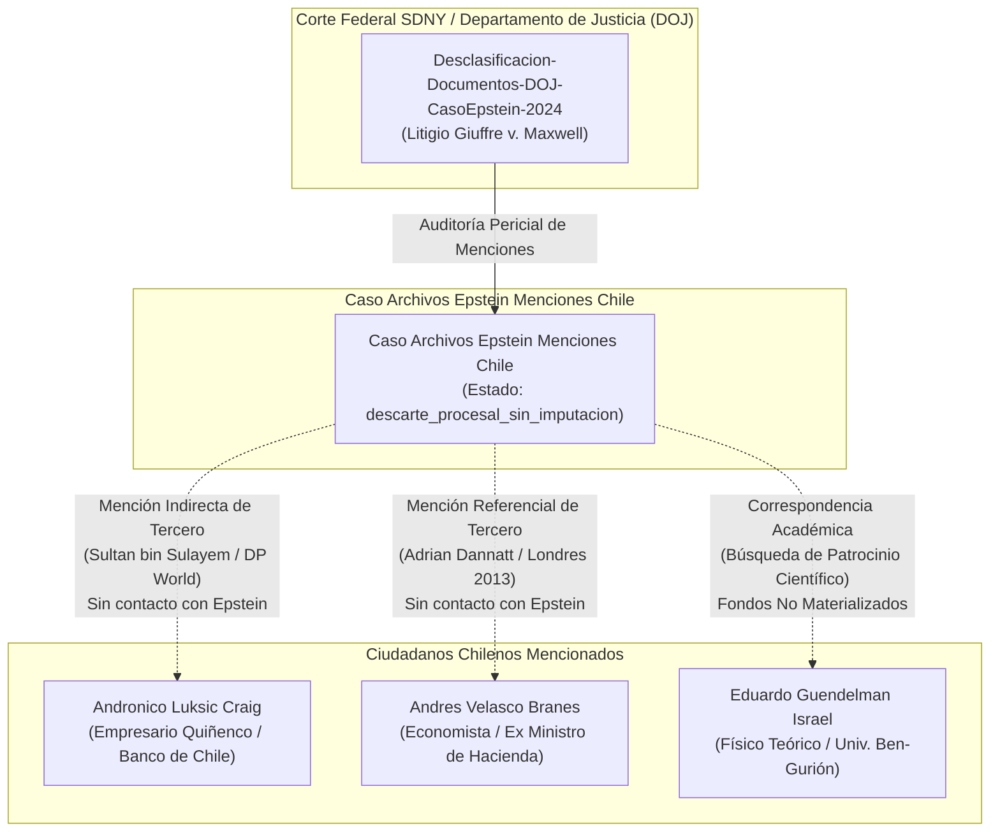

# Auditoría Forense de Desclasificaciones Internacionales: Menciones a Chilenos en Archivos Epstein

> **Marco de Verificación Pericial y Prevención de Injurias**: En la modelación de grafos forenses inspirados en **OCCRP Aleph** y el Consorcio Internacional de Periodistas de Investigación (**ICIJ**), la aparición de un nombre propio en acervos documentales masivos o filtraciones no equivale automáticamente a la imputación de un delito. Tratándose de millones de páginas de correspondencia desclasificada por tribunales de EE. UU. ([[Desclasificacion-Documentos-DOJ-CasoEpstein-2024]]), atribuir ilícitos a personas mencionadas incidentalmente por terceros constituye una vulneración de los estándares periciales y puede configurar los tipos penales de injuria o calumnia. Esta vista clasifica y audita con precisión el nivel de interacción de los ciudadanos chilenos individualizados.

---

## 1. Matriz de Atribución y Niveles Probatorios

| Sujeto Individualizado | Rol / Ocupación | Tipo de Mención en Archivos Desclasificados | Interacción Directa con Epstein | Aporte Financiero / Transacción | Situación Procesal / Determinación Forense |
| :--- | :--- | :--- | :---: | :---: | :--- |
| **[[Andronico Luksic Craig]]** | Empresario, expresidente de Quiñenco y Banco de Chile | **Mención indirecta de un tercero**: Sultan bin Sulayem (DP World) adjuntó su CV a Epstein preguntando si lo conocía con fines comerciales en Dubái ([[TRX-2015-11-14-Mencion-Indirecta-Epstein-BinSulayem-Luksic-01]]) | **No** (Sin respuesta ni contacto registrado) | **$0 CLP** | **Descarte procesal**: Sin vínculo delictual, societario ni personal. Desmentido público y categórico. |
| **[[Andres Velasco Branes]]** | Economista, exministro de Hacienda y decano en LSE | **Mención referencial de un tercero**: Correo de Adrian Dannatt (*«Future President of Chile etc.»*) comentando su paso por Harvard y una cena en Londres en 2013 ([[TRX-2013-05-20-Mencion-Referencial-Epstein-Dannatt-Velasco-01]]) | **No** (Sin comunicación ni contacto registrado) | **$0 CLP** | **Descarte procesal**: Comentario social de terceros sobre política internacional. Sin relación con los hechos delictuales. |
| **[[Eduardo Guendelman Israel]]** | Doctor en Física Teórica y Profesor Emérito (Univ. Ben-Gurión) | **Intercambio epistolar académico**: Correos entre 2015 y 2019 solicitando patrocinio para conferencias científicas y centro de física en Bahamas ([[TRX-2015-08-10-Contacto-Academico-Patrocinio-Guendelman-Epstein-01]]) | **Sí** (Vía correo electrónico institucional) | **$0 CLP** (Donación nunca materializada) | **Descarte procesal**: Gestión académica estrictamente científica; financiamiento nunca concedido. Sin cargos penales. |

---

## 2. Diagrama de Topología Documental

---

## 3. Bitácoras de Vuelo (*Flight Logs*) y Verificaciones Policiales
- **Aeronaves privadas de Jeffrey Epstein**: En los manifiestos oficiales de pasajeros desclasificados del avión *Boeing 727* (N908JE) y demás aeronaves de la flota de Epstein no figura ninguna autoridad de gobierno, parlamentario, diplomático ni empresario chileno.
- **Diligencias en Chile**: Tras peticiones parlamentarias de información en 2020 a la Policía de Investigaciones (PDI) e Interpol, no se acreditó la existencia de ramificaciones locales ni de operaciones de la red en territorio chileno.

---

## 4. Estándar de la Bóveda contra la Desinformación
El modelo de datos de este repositorio exige para toda imputación activa:
1. Una resolución judicial formal (formalización, auto de procesamiento, acusación o condena ejecutoriada).
2. Un flujo financiero periciado (`monto_clp > 0`) comprobado mediante cartolas, facturas o comprobantes bancarios.

Las entidades de este expediente se mantienen indexadas con `situacion_procesal: ninguna` y montos de `$0 CLP`, garantizando que la inteligencia de fuentes abiertas distinga con total fidelidad entre hechos acreditados y menciones contextuales desestimadas.
