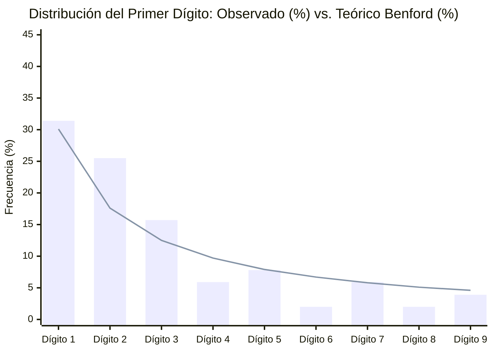

# Distribución de Montos: Ley de Benford y Montos Redondos

> [!WARNING] Análisis exploratorio, no prueba de responsabilidad
> Este reporte aplica métricas de análisis de redes a los datos del vault. Sus resultados describen la estructura del grafo, no hechos: una cercanía, un agrupamiento o un par similar no indica que exista una relación, un acuerdo ni un delito. Los datos tienen calidades distintas (ver `monto_origen` y `estado_verificacion`) y pueden contener errores. Toda persona mencionada se presume inocente mientras no exista sentencia condenatoria firme. No citar estos resultados como prueba ni como acusación.
>
> Una desviación estadística en la distribución de montos no prueba manipulación ni fraude; puede deberse al tamaño reducido de la muestra o a cómo se registraron las cifras.

- **Operaciones Monetarias Analizadas (`monto_clp > 0`)**: **51**
- **Operaciones con Monto Redondo Discrecional (Múltiplos de `$10.000.000 CLP`)**: **36 de 51 (70.6%)**

---

## 1. Curva de Primer Dígito Significativo vs. Ley de Benford (`xychart-beta`)

| Primer Dígito ($d$) | Conteo Observado | Frecuencia Observada (%) | Frecuencia Esperada Benford (%) | Desviación ($\Delta$) |
| :---: | :---: | ---: | ---: | ---: |
| **1** | 16 | 31.4% | 30.1% | `+1.3%` |
| **2** | 13 | 25.5% | 17.6% | `+7.9%` |
| **3** | 8 | 15.7% | 12.5% | `+3.2%` |
| **4** | 3 | 5.9% | 9.7% | `-3.8%` |
| **5** | 4 | 7.8% | 7.9% | `-0.1%` |
| **6** | 1 | 2.0% | 6.7% | `-4.7%` |
| **7** | 3 | 5.9% | 5.8% | `+0.1%` |
| **8** | 1 | 2.0% | 5.1% | `-3.1%` |
| **9** | 2 | 3.9% | 4.6% | `-0.7%` |

---

## 2. Detección de Sesgo de Redondeo Artificial (Múltiplos Exactos de `$10.000.000 CLP`)

En contabilidad, los presupuestos basados en cubicaciones reales de obra o nóminas efectivas rara vez terminan en múltiplos exactos de diez millones de pesos (ej. [[TRX-2016-11-10-Desfalco-Intendencia-Carabineros-01]] por `$28.348.928.198` o [[TRX-2022-12-20-Convenio-EnTi-01]] por `$250.635.000`). Las cifras cerradas pueden reflejar montos estimados, redondeados por la fuente o fijados por acuerdo, y no indican por sí solas una irregularidad:

| Nexo (`TRX`) | Fecha | Tipo | Origen | Destino | Monto Redondo (CLP) | Causa |
| :--- | :---: | :---: | :--- | :--- | ---: | :--- |
| [[TRX-2023-12-14-Emision-Facturas-Falsas-Fraude-SII-Operacion-Tributos-01]] | 2023-12-14 | `factura_falsa` | [[]] | [[Servicio Impuestos Internos]] | **$240.000.000.000** | [[Caso Megafraude Tributario Operacion Tributos]] |
| [[TRX-2017-03-03-Compensacion-Historica-Consumidores-CMPC-SERNAC-01]] | 2017-03-03 | `compensacion_reparatoria` | [[Empresas CMPC SA]] | [[Servicio Nacional del Consumidor]] | **$97.500.000.000** | [[Caso Colusion del Papel Tissue]] |
| [[TRX-2010-12-10-Compraventa-Offshore-Dominga-Bancard-Delano-01]] | 2010-12-10 | `trato_directo` | [[Andes Iron SpA]] | [[Bancard Inversiones Ltda]] | **$75.500.000.000** | [[Caso Minera Dominga Pandora Papers]] |
| [[TRX-2015-10-29-Pago-Multas-Historicas-Cartel-Pollos-01]] | 2015-10-29 | `compensacion_reparatoria` | [[Agrosuper SA]] | [[Corte Suprema de Chile]] | **$38.400.000.000** | [[Caso Colusion de los Pollos]] |
| [[TRX-2016-04-05-Fundaciones-Offshore-MossackFonseca-Edwards-Ovalle-01]] | 2016-04-05 | `desviacion_fondos` | [[Mossack Fonseca y Sociedades Offshore Panama]] | [[Unidad de Analisis Financiero]] | **$19.500.000.000** | [[Caso Panama Papers Chile]] |
| [[TRX-1982-08-28-Creditos-Relacionados-BancoDeTalca-Pinera-01]] | 1982-08-28 | `desviacion_fondos` | [[Bancard Inversiones Ltda]] | [[Corte Suprema de Chile]] | **$18.500.000.000** | [[Caso LAN Informacion Privilegiada y Banco de Talca]] |
| [[TRX-2004-07-14-Desvio-Gastos-Reservados-Riggs-Pinochet-01]] | 2004-07-14 | `desviacion_fondos` | [[Comando de Apoyo a la Fuerza del Ejercito]] | [[Riggs Bank y Sociedades Offshore Ashburton]] | **$15.800.000.000** | [[Caso Riggs]] |
| [[TRX-1972-10-12-Fondos-Desestabilizacion-Gremios-ParoCamioneros-CIA-01]] | 1972-10-12 | `gestion_influencia` | [[Agencia Central de Inteligencia CIA y Escuela de las Americas]] | [[Comando de Apoyo a la Fuerza del Ejercito]] | **$14.800.000.000** | [[Caso Operacion FUBELT Intervencion CIA y DINA]] |
| [[TRX-2016-04-03-Estructuracion-Offshore-MossackFonseca-Delaveau-01]] | 2016-04-03 | `gestion_influencia` | [[Mossack Fonseca y Sociedades Offshore Panama]] | [[Servicio Impuestos Internos]] | **$14.200.000.000** | [[Caso Panama Papers Chile]] |
| [[TRX-2016-08-12-Enajenacion-Inmuebles-Fiscales-CEMAChile-01]] | 2016-08-12 | `desviacion_fondos` | [[Fundacion CEMA Chile]] | [[Corte Suprema de Chile]] | **$10.500.000.000** | [[Caso CEMA Chile]] |
| [[TRX-1971-09-09-Financiamiento-Encubierto-CIA-ElMercurio-Edwards-01]] | 1971-09-09 | `desviacion_fondos` | [[Agencia Central de Inteligencia CIA y Escuela de las Americas]] | [[Empresa El Mercurio SAP]] | **$9.500.000.000** | [[Caso Operacion FUBELT Intervencion CIA y DINA]] |
| [[TRX-2012-11-20-Inversion-Offshore-Bancard-Exalmar-LaHaya-01]] | 2012-11-20 | `gestion_influencia` | [[Bancard Inversiones Ltda]] | [[Contraloria General de la Republica]] | **$8.250.000.000** | [[Caso Exalmar y Fideicomiso Ciego]] |
| [[TRX-2014-05-20-Facturas-LeyReservadaCobre-01]] | 2014-05-20 | `transferencia` | [[Comando de Apoyo a la Fuerza del Ejercito]] | [[Frasim Ltda]] | **$6.100.000.000** | [[Caso Milicogate]] |
| [[TRX-2006-07-24-Compra-Acciones-Informacion-Privilegiada-LAN-01]] | 2006-07-24 | `gestion_influencia` | [[Bancard Inversiones Ltda]] | [[Comision para el Mercado Financiero]] | **$5.300.000.000** | [[Caso LAN Informacion Privilegiada y Banco de Talca]] |
| [[TRX-2016-04-15-Cruce-Offshore-MossackFonseca-Riggs-Pinochet-01]] | 2016-04-15 | `desviacion_fondos` | [[Mossack Fonseca y Sociedades Offshore Panama]] | [[Riggs Bank y Sociedades Offshore Ashburton]] | **$3.800.000.000** | [[Caso Panama Papers Chile]] |
| [[TRX-2015-08-14-Lavado-GastosReservados-Ejercito-UAF-01]] | 2015-08-14 | `desviacion_fondos` | [[Comando de Apoyo a la Fuerza del Ejercito]] | [[Unidad de Analisis Financiero]] | **$3.500.000.000** | [[Caso Milicogate]] |
| [[TRX-1991-01-31-Vaciamiento-Patrimonial-Evasion-ColoniaDignidad-01]] | 1991-01-31 | `desviacion_fondos` | [[Sociedad Benefactora y Educacional Dignidad]] | [[Servicio Impuestos Internos]] | **$3.450.000.000** | [[Caso Colonia Dignidad]] |
| [[TRX-1989-01-10-Emision-Pinocheques-Ejercito-Valmoval-01]] | 1989-01-10 | `desviacion_fondos` | [[Comando de Apoyo a la Fuerza del Ejercito]] | [[Valmoval Ltda]] | **$2.950.000.000** | [[Caso Pinocheques]] |
| [[TRX-2015-01-29-Facturas-Falsas-Caval-SII-01]] | 2015-01-29 | `factura_falsa` | [[Exportadora y de Gestion Caval Ltda]] | [[Servicio Impuestos Internos]] | **$2.500.000.000** | [[Caso Caval]] |
| [[TRX-2005-08-10-Evasion-Tributaria-Cuentas-Riggs-SII-01]] | 2005-08-10 | `desviacion_fondos` | [[Riggs Bank y Sociedades Offshore Ashburton]] | [[Servicio Impuestos Internos]] | **$2.450.000.000** | [[Caso Riggs]] |
| [[TRX-2020-11-25-Compensacion-Indemnizatoria-Consumidores-Farmacias-01]] | 2020-11-25 | `compensacion_reparatoria` | [[Farmacias Salcobrand SA]] | [[Servicio Nacional del Consumidor]] | **$2.180.000.000** | [[Caso Colusion de las Farmacias]] |
| [[TRX-1975-08-15-Pagos-CIA-Entrenamiento-SOA-DINA-Contreras-01]] | 1975-08-15 | `desviacion_fondos` | [[Agencia Central de Inteligencia CIA y Escuela de las Americas]] | [[Corte Suprema de Chile]] | **$2.100.000.000** | [[Caso Operacion FUBELT Intervencion CIA y DINA]] |
| [[TRX-2017-03-06-Lavado-Activos-Carabineros-UAF-01]] | 2017-03-06 | `desviacion_fondos` | [[Direccion de Finanzas de Carabineros]] | [[Unidad de Analisis Financiero]] | **$1.450.000.000** | [[Caso Pacogate]] |
| [[TRX-2013-07-15-Boletas-Falsas-Penta-UDI-01]] | 2013-07-15 | `factura_falsa` | [[Empresas Penta SA]] | [[Union Democrata Independiente]] | **$1.260.000.000** | [[Caso Penta]] |
| [[TRX-2012-03-22-Fraude-Residuos-CerroNavia-01]] | 2012-03-22 | `trato_directo` | [[Municipalidad de Cerro Navia]] | [[KDM Empresas SA]] | **$1.120.000.000** | [[Caso Basura]] |
| [[TRX-2010-08-19-Correo-Royalty-SQM-01]] | 2010-08-19 | `cohecho` | [[SQM SA]] | [[Union Democrata Independiente]] | **$730.000.000** | [[Caso SQM]] |
| [[TRX-2022-10-28-Convenio-ProCultura-Antofagasta]] | 2022-10-28 | `convenio_directo` | [[Seremi MINVU Antofagasta]] | [[Fundacion ProCultura]] | **$500.000.000** | [[Caso Convenios]] |
| [[TRX-2003-10-15-Ocultamiento-Patrimonial-ElBosque-Spiniak-01]] | 2003-10-15 | `desviacion_fondos` | [[Inversiones El Bosque Ltda]] | [[Servicio Impuestos Internos]] | **$480.000.000** | [[Caso Spiniak]] |
| [[TRX-2023-08-25-Reporte-ROS-Factop-UAF-01]] | 2023-08-25 | `factura_falsa` | [[Factop SpA]] | [[Unidad de Analisis Financiero]] | **$480.000.000** | [[Caso Audios]] |
| [[TRX-2009-11-18-Facturas-Falsas-Bancard-SQM-Campana-Pinera-01]] | 2009-11-18 | `factura_falsa` | [[SQM SA]] | [[Bancard Inversiones Ltda]] | **$340.000.000** | [[Caso SQM]] |
| [[TRX-1996-06-12-Blindaje-Politico-Judicial-ColoniaDignidad-01]] | 1996-06-12 | `gestion_influencia` | [[Union Democrata Independiente]] | [[Sociedad Benefactora y Educacional Dignidad]] | **$240.000.000** | [[Caso Colonia Dignidad]] |
| [[TRX-2022-10-03-Convenio-DV-01]] | 2022-10-03 | `convenio_directo` | [[Seremi MINVU Antofagasta]] | [[Fundacion Democracia Viva]] | **$200.000.000** | [[Caso Convenios]] |
| [[TRX-2019-12-11-Defensa-AC-Transferencias-Factop-Hermosilla-Chadwick-01]] | 2019-12-11 | `transferencia` | [[Factop SpA]] | [[Senado de la Republica de Chile]] | **$190.000.000** | [[Caso Audios]] |
| [[TRX-2022-10-19-Convenio-DV-02]] | 2022-10-19 | `convenio_directo` | [[Seremi MINVU Antofagasta]] | [[Fundacion Democracia Viva]] | **$170.000.000** | [[Caso Convenios]] |
| [[TRX-2003-11-05-Operacion-Politico-Judicial-Spiniak-01]] | 2003-11-05 | `gestion_influencia` | [[Renovacion Nacional]] | [[Corte Suprema de Chile]] | **$120.000.000** | [[Caso Spiniak]] |
| [[TRX-2023-06-22-Reunion-Audios-01]] | 2023-06-22 | `cohecho` | [[Factop SpA]] | [[Servicio Impuestos Internos]] | **$100.000.000** | [[Caso Audios]] |
