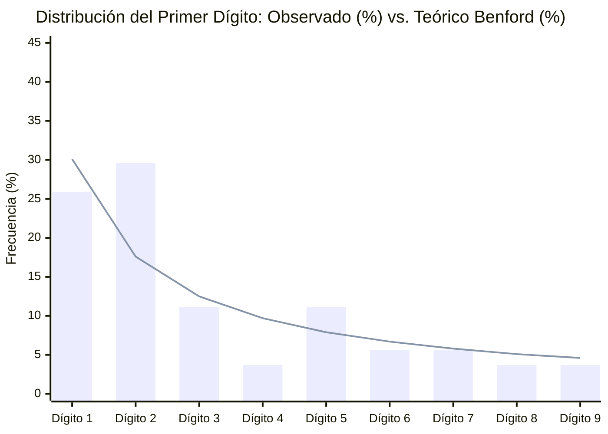

# Distribución de Montos: Ley de Benford y Montos Redondos

> [!WARNING] Análisis exploratorio, no prueba de responsabilidad
> Este reporte aplica métricas de análisis de redes a los datos del vault. Sus resultados describen la estructura del grafo, no hechos: una cercanía, un agrupamiento o un par similar no indica que exista una relación, un acuerdo ni un delito. Los datos tienen calidades distintas (ver `monto_origen` y `estado_verificacion`) y pueden contener errores. Toda persona mencionada se presume inocente mientras no exista sentencia condenatoria firme. No citar estos resultados como prueba ni como acusación.
>
> Una desviación estadística en la distribución de montos no prueba manipulación ni fraude; puede deberse al tamaño reducido de la muestra o a cómo se registraron las cifras.

- **Operaciones Monetarias Analizadas (`monto_clp > 0`)**: **54**
- **Operaciones con Monto Redondo Discrecional (Múltiplos de `$10.000.000 CLP`)**: **30 de 54 (55.6%)**

---

## 1. Curva de Primer Dígito Significativo vs. Ley de Benford (`xychart-beta`)

| Primer Dígito ($d$) | Conteo Observado | Frecuencia Observada (%) | Frecuencia Esperada Benford (%) | Desviación ($\Delta$) |
| :---: | :---: | ---: | ---: | ---: |
| **1** | 14 | 25.9% | 30.1% | `-4.2%` |
| **2** | 16 | 29.6% | 17.6% | `+12.0%` |
| **3** | 6 | 11.1% | 12.5% | `-1.4%` |
| **4** | 2 | 3.7% | 9.7% | `-6.0%` |
| **5** | 6 | 11.1% | 7.9% | `+3.2%` |
| **6** | 3 | 5.6% | 6.7% | `-1.1%` |
| **7** | 3 | 5.6% | 5.8% | `-0.2%` |
| **8** | 2 | 3.7% | 5.1% | `-1.4%` |
| **9** | 2 | 3.7% | 4.6% | `-0.9%` |

---

## 2. Detección de Sesgo de Redondeo Artificial (Múltiplos Exactos de `$10.000.000 CLP`)

En contabilidad, los presupuestos basados en cubicaciones reales de obra o nóminas efectivas rara vez terminan en múltiplos exactos de diez millones de pesos (ej. [[TRX-2016-11-10-Fondos-Direccion-Finanzas-Carabineros-01]] por `$28.348.928.198` o [[TRX-2022-12-20-Convenio-EnTi-01]] por `$250.635.000`). Las cifras cerradas pueden reflejar montos estimados, redondeados por la fuente o fijados por acuerdo, y no indican por sí solas una irregularidad:

| Nexo (`TRX`) | Fecha | Tipo | Origen | Destino | Monto Redondo (CLP) | Causa |
| :--- | :---: | :---: | :--- | :--- | ---: | :--- |
| [[TRX-2023-12-14-Perjuicio-Fiscal-Operacion-Tributos-01]] | 2023-12-14 | `factura_falsa` | [[]] | [[Servicio Impuestos Internos]] | **$240.000.000.000** | [[Caso Megafraude Tributario Operacion Tributos]] |
| [[TRX-1994-01-21-Operaciones-Futuros-Codelco-Davilazo-01]] | 1994-01-21 | `transferencia` | [[Corporacion Nacional del Cobre de Chile]] | [[Servicio Impuestos Internos]] | **$98.580.000.000** | [[Caso Codelco Davilazo]] |
| [[TRX-2017-03-03-Compensacion-Historica-Consumidores-CMPC-SERNAC-01]] | 2017-03-03 | `compensacion_reparatoria` | [[Empresas CMPC SA]] | [[Servicio Nacional del Consumidor]] | **$97.500.000.000** | [[Caso Colusion del Papel Tissue]] |
| [[TRX-2010-12-10-Compraventa-Offshore-Dominga-Bancard-Delano-01]] | 2010-12-10 | `trato_directo` | [[Andes Iron SpA]] | [[Bancard Inversiones Ltda]] | **$75.500.000.000** | [[Caso Minera Dominga Pandora Papers]] |
| [[TRX-2016-03-01-Estafa-Piramidal-Lavado-ACInversions-01]] | 2016-03-01 | `transferencia` | [[AC Inversions SpA]] | [[Unidad de Analisis Financiero]] | **$50.000.000.000** | [[Caso AC Inversions]] |
| [[TRX-2015-10-29-Pago-Multas-Colusion-Pollos-01]] | 2015-10-29 | `compensacion_reparatoria` | [[Agrosuper SA]] | [[Corte Suprema de Chile]] | **$38.400.000.000** | [[Caso Colusion de los Pollos]] |
| [[TRX-2020-08-14-Multas-Colusion-Navieras-CarCarriers-01]] | 2020-08-14 | `transferencia` | [[Compania Maritima de Chile SA]] | [[Fiscalia Nacional Economica]] | **$24.100.000.000** | [[Caso Colusion de las Navieras]] |
| [[TRX-2020-04-08-Multas-Colusion-Supermercados-Pollo-01]] | 2020-04-08 | `transferencia` | [[Cencosud SA]] | [[Fiscalia Nacional Economica]] | **$18.300.000.000** | [[Caso Colusion de los Supermercados]] |
| [[TRX-2004-07-14-Gastos-Reservados-Riggs-01]] | 2004-07-14 | `desviacion_fondos` | [[Comando de Apoyo a la Fuerza del Ejercito]] | [[Riggs Bank y Sociedades Offshore Ashburton]] | **$15.800.000.000** | [[Caso Riggs]] |
| [[TRX-2012-11-20-Inversion-Offshore-Bancard-Exalmar-LaHaya-01]] | 2012-11-20 | `gestion_influencia` | [[Bancard Inversiones Ltda]] | [[Contraloria General de la Republica]] | **$8.250.000.000** | [[Caso Exalmar y Fideicomiso Ciego]] |
| [[TRX-2014-05-20-Facturas-LeyReservadaCobre-01]] | 2014-05-20 | `transferencia` | [[Comando de Apoyo a la Fuerza del Ejercito]] | [[Frasim Ltda]] | **$6.100.000.000** | [[Caso Milicogate]] |
| [[TRX-1994-12-15-Comisiones-Compra-Aviones-Mirage-FACh-01]] | 1994-12-15 | `soborno` | [[Fuerza Aerea de Chile]] | [[Riggs Bank y Sociedades Offshore Ashburton]] | **$6.000.000.000** | [[Caso Mirage]] |
| [[TRX-2006-07-24-Compra-Acciones-Informacion-Privilegiada-LAN-01]] | 2006-07-24 | `gestion_influencia` | [[Bancard Inversiones Ltda]] | [[Comision para el Mercado Financiero]] | **$5.300.000.000** | [[Caso LAN Informacion Privilegiada y Banco de Talca]] |
| [[TRX-2015-08-14-GastosReservados-Ejercito-UAF-01]] | 2015-08-14 | `desviacion_fondos` | [[Comando de Apoyo a la Fuerza del Ejercito]] | [[Unidad de Analisis Financiero]] | **$3.500.000.000** | [[Caso Milicogate]] |
| [[TRX-1989-01-10-Emision-Pinocheques-Ejercito-Valmoval-01]] | 1989-01-10 | `desviacion_fondos` | [[Comando de Apoyo a la Fuerza del Ejercito]] | [[Valmoval Ltda]] | **$2.950.000.000** | [[Caso Pinocheques]] |
| [[TRX-2015-01-29-Facturas-Caval-SII-01]] | 2015-01-29 | `factura_falsa` | [[Exportadora y de Gestion Caval Ltda]] | [[Servicio Impuestos Internos]] | **$2.500.000.000** | [[Caso Caval]] |
| [[TRX-2005-08-10-Querella-SII-Cuentas-Riggs-01]] | 2005-08-10 | `desviacion_fondos` | [[Riggs Bank y Sociedades Offshore Ashburton]] | [[Servicio Impuestos Internos]] | **$2.450.000.000** | [[Caso Riggs]] |
| [[TRX-2020-11-25-Compensacion-Indemnizatoria-Consumidores-Farmacias-01]] | 2020-11-25 | `compensacion_reparatoria` | [[Farmacias Salcobrand SA]] | [[Servicio Nacional del Consumidor]] | **$2.180.000.000** | [[Caso Colusion de las Farmacias]] |
| [[TRX-2014-07-24-Sanciones-SVS-CS-Auditorias-PwC-LaPolar-Cascadas-01]] | 2015-07-24 | `transferencia` | [[PricewaterhouseCoopers Consultores Auditores SpA]] | [[Empresas La Polar SA]] | **$2.100.000.000** | [[Caso La Polar]] |
| [[TRX-2017-03-06-Reportes-UAF-Carabineros-01]] | 2017-03-06 | `desviacion_fondos` | [[Direccion de Finanzas de Carabineros]] | [[Unidad de Analisis Financiero]] | **$1.450.000.000** | [[Caso Pacogate]] |
| [[TRX-2013-07-15-Boletas-Penta-UDI-01]] | 2013-07-15 | `factura_falsa` | [[Empresas Penta SA]] | [[Union Democrata Independiente]] | **$1.260.000.000** | [[Caso Penta]] |
| [[TRX-2012-03-22-Contratos-Residuos-CerroNavia-01]] | 2012-03-22 | `trato_directo` | [[Municipalidad de Cerro Navia]] | [[KDM Empresas SA]] | **$1.120.000.000** | [[Caso Basura]] |
| [[TRX-2010-08-19-Correo-Royalty-SQM-01]] | 2010-08-19 | `cohecho` | [[SQM SA]] | [[Union Democrata Independiente]] | **$730.000.000** | [[Caso SQM]] |
| [[TRX-2022-10-28-Convenio-ProCultura-Antofagasta]] | 2022-10-28 | `convenio_directo` | [[Seremi MINVU Antofagasta]] | [[Fundacion ProCultura]] | **$500.000.000** | [[Caso Convenios]] |
| [[TRX-2009-11-18-Facturas-Bancard-SQM-2009-01]] | 2009-11-18 | `factura_falsa` | [[SQM SA]] | [[Bancard Inversiones Ltda]] | **$340.000.000** | [[Caso SQM]] |
| [[TRX-2022-10-03-Convenio-DV-01]] | 2022-10-03 | `convenio_directo` | [[Seremi MINVU Antofagasta]] | [[Fundacion Democracia Viva]] | **$200.000.000** | [[Caso Convenios]] |
| [[TRX-2019-12-11-Defensa-AC-Transferencias-Factop-Hermosilla-Chadwick-01]] | 2019-12-11 | `transferencia` | [[Factop SpA]] | [[Senado de la Republica de Chile]] | **$190.000.000** | [[Caso Audios]] |
| [[TRX-2022-10-19-Convenio-DV-02]] | 2022-10-19 | `convenio_directo` | [[Seremi MINVU Antofagasta]] | [[Fundacion Democracia Viva]] | **$170.000.000** | [[Caso Convenios]] |
| [[TRX-2023-06-22-Reunion-Audios-01]] | 2023-06-22 | `cohecho` | [[Factop SpA]] | [[Servicio Impuestos Internos]] | **$100.000.000** | [[Caso Audios]] |
| [[TRX-2002-10-15-Sobornos-Plantas-Revision-Tecnica-Coimas-01]] | 2002-10-15 | `soborno` | [[Partido Democrata Cristiano]] | [[Ministerio de Obras Publicas]] | **$20.000.000** | [[Caso Coimas]] |
