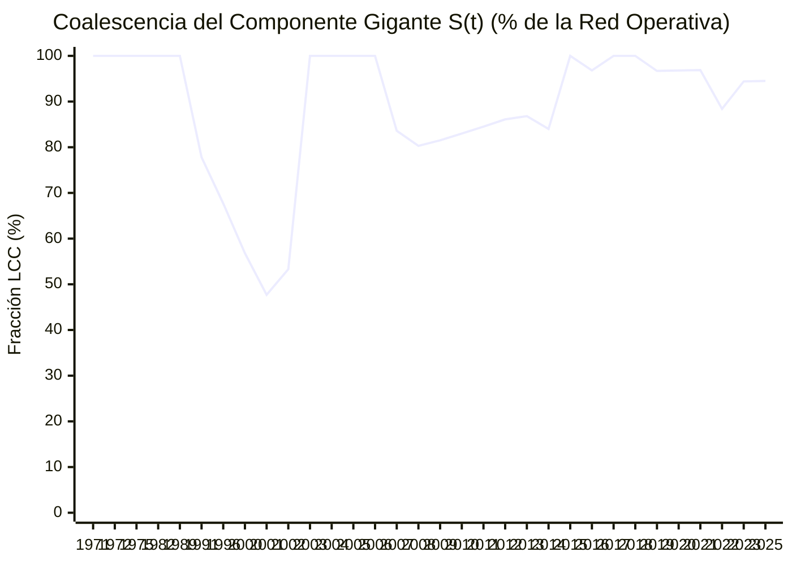

# ⏳ Evolución Temporal $G(t)$, Transición de Fase de Molloy-Reed y Ráfagas de Goh-Barabási

> [!IMPORTANT] Dinámica No Lineal de Redes Criminales y Coalescencia del Componente Gigante
> Esta vista reconstruye el grafo acumulado $G(t) = (V(t), E(t))$ desde `2001` hasta `2023` a medida que se activan cronológicamente los nexos transaccionales (`TRX`):
> 1. **Criterio de Percolación de Molloy-Reed ($\kappa(t) = \langle k^2 \rangle / \langle k \rangle > 2$)**: Determina en qué momento la red supera el umbral crítico $\kappa_c = 2.0$ y experimenta una **transición de fase hacia un régimen supercrítico macro-conectado**.
> 2. **Coeficiente de Ráfaga Temporal de Goh & Barabási ($B \in [-1, 1]$)**: Evalúa si las transacciones ilícitas ocurren de forma independiente o en **ráfagas sincronizadas ($B > 0$)** asociadas a ciclos electorales y presupuestarios.

## 1. Métricas Dinámicas e Inter-Transaccionales (2001–2023)

- **Coeficiente de Ráfaga Temporal de Goh-Barabási ($B$)**: **`+0.2741`**
  - *Diagnóstico Cronológico*: **Dinámica de Ráfagas Sincronizadas (*Burst-Driven Process*, $B > 0$: los desembolsos se concentran en ventanas electorales y cierres presupuestarios)**
- **Intervalo Medio entre Transacciones ($\mu_\tau$)**: `282.3 días` | **Desviación Estándar ($\sigma_\tau$)**: `495.5 días`
- **Parámetro de Molloy-Reed Actual ($\kappa(2023) = \langle k^2 \rangle / \langle k \rangle$)**: **`4.5013`** *(Supercrítico: $\kappa > 2.0$)*
- **Coalescencia del Componente Gigante ($S(2023)$)**: **`94.5%`** (`223` de `236` nodos operativos unidos en un único macro-componente)

---

## 2. Serie Histórica Acumulada $G(t)$ y Transición de Fase (`2001 → 2023`)

| Año ($t$) | TRX Acum. | Nodos $|V(t)|$ | Aristas $|E(t)|$ | LCC $|V_{\text{LCC}}(t)|$ | Fracción Gigante $S(t)$ | Molloy-Reed $\kappa(t)$ | Monto Acumulado $\Phi(t)$ |
| :---: | :---: | :---: | :---: | :---: | :---: | :---: | :---: |
| **1971** | `1` | `6` | `7` | `6` | **`100.0%`** | `3.00` | `$9.500.000.000 CLP` |
| **1972** | `2` | `9` | `12` | `9` | **`100.0%`** | `3.42` | `$24.300.000.000 CLP` |
| **1975** | `3` | `11` | `17` | `11` | **`100.0%`** | `3.76` | `$26.400.000.000 CLP` |
| **1982** | `4` | `17` | `24` | `17` | **`100.0%`** | `3.58` | `$44.900.000.000 CLP` |
| **1989** | `5` | `21` | `31` | `21` | **`100.0%`** | `3.65` | `$47.850.000.000 CLP` |
| **1991** | `6` | `27` | `37` | `21` | **`77.8%`** | `3.54` | `$51.300.000.000 CLP` |
| **1996** | `7` | `31` | `43` | `21` | **`67.7%`** | `3.53` | `$51.540.000.000 CLP` |
| **2000** | `8` | `37` | `49` | `21` | **`56.8%`** | `3.49` | `$51.540.000.000 CLP` |
| **2001** | `9` | `44` | `57` | `21` | **`47.7%`** | `3.42` | `$52.793.000.000 CLP` |
| **2002** | `10` | `45` | `62` | `24` | **`53.3%`** | `3.53` | `$53.243.000.000 CLP` |
| **2003** | `12` | `51` | `74` | `51` | **`100.0%`** | `3.58` | `$53.843.000.000 CLP` |
| **2004** | `13` | `55` | `80` | `55` | **`100.0%`** | `3.61` | `$69.643.000.000 CLP` |
| **2005** | `15` | `58` | `92` | `58` | **`100.0%`** | `3.83` | `$73.943.000.000 CLP` |
| **2006** | `16` | `61` | `98` | `61` | **`100.0%`** | `3.84` | `$79.243.000.000 CLP` |
| **2007** | `18` | `73` | `110` | `61` | **`83.6%`** | `3.75` | `$79.243.000.000 CLP` |
| **2008** | `19` | `76` | `115` | `61` | **`80.3%`** | `3.76` | `$79.243.000.000 CLP` |
| **2009** | `20` | `81` | `122` | `66` | **`81.5%`** | `3.75` | `$79.583.000.000 CLP` |
| **2010** | `24` | `94` | `147` | `78` | **`83.0%`** | `3.86` | `$174.313.000.000 CLP` |
| **2011** | `26` | `103` | `163` | `87` | **`84.5%`** | `3.98` | `$198.855.000.000 CLP` |
| **2012** | `29` | `115` | `182` | `99` | **`86.1%`** | `4.03` | `$208.458.000.000 CLP` |
| **2013** | `32` | `121` | `196` | `105` | **`86.8%`** | `4.21` | `$209.874.000.000 CLP` |
| **2014** | `34` | `131` | `207` | `110` | **`84.0%`** | `4.15` | `$216.114.000.000 CLP` |
| **2015** | `39` | `142` | `228` | `142` | **`100.0%`** | `4.18` | `$260.514.000.000 CLP` |
| **2016** | `44` | `157` | `254` | `152` | **`96.8%`** | `4.26` | `$336.862.928.198 CLP` |
| **2017** | `48` | `167` | `273` | `167` | **`100.0%`** | `4.25` | `$435.837.928.198 CLP` |
| **2018** | `49` | `169` | `278` | `169` | **`100.0%`** | `4.29` | `$435.837.928.198 CLP` |
| **2019** | `51` | `180` | `292` | `174` | **`96.7%`** | `4.29` | `$439.227.928.198 CLP` |
| **2020** | `53` | `185` | `302` | `179` | **`96.8%`** | `4.31` | `$472.379.928.198 CLP` |
| **2021** | `54` | `191` | `309` | `185` | **`96.9%`** | `4.29` | `$473.138.928.198 CLP` |
| **2022** | `63` | `216` | `359` | `191` | **`88.4%`** | `4.35` | `$476.868.563.198 CLP` |
| **2023** | `70` | `233` | `395` | `220` | **`94.4%`** | `4.50` | `$725.963.563.198 CLP` |
| **2025** | `71` | `236` | `399` | `223` | **`94.5%`** | `4.50` | `$725.998.563.198 CLP` |

---

## 3. Curva de Crecimiento del Componente Gigante $S(t)$ y Caudal Auditado

