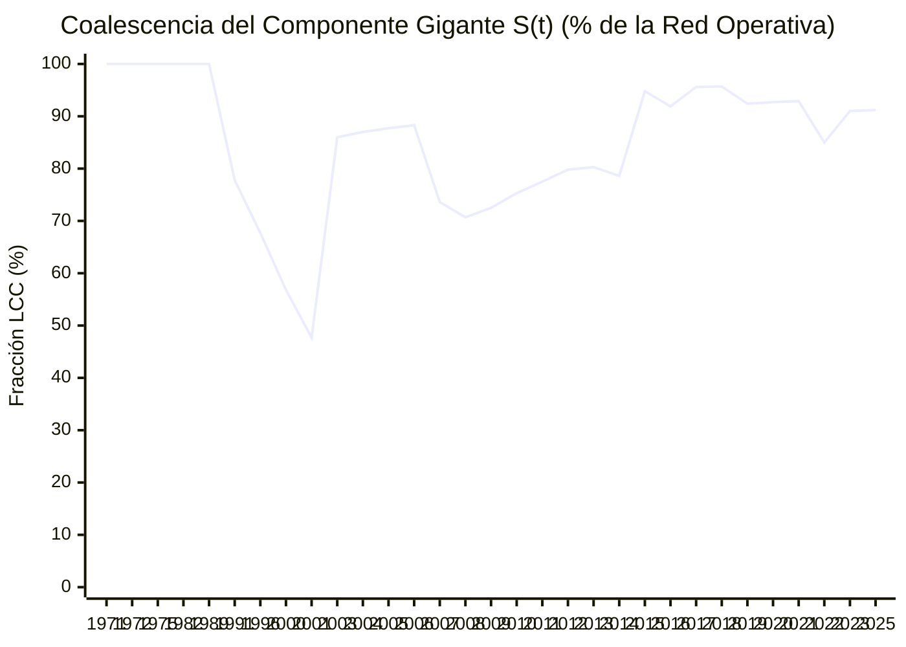

# Evolución Temporal $G(t)$, Transición de Fase de Molloy-Reed y Ráfagas de Goh-Barabási

> [!WARNING] Análisis exploratorio, no prueba de responsabilidad
> Este reporte aplica métricas de análisis de redes a los datos del vault. Sus resultados describen la estructura del grafo, no hechos: una cercanía, un agrupamiento o un par similar no indica que exista una relación, un acuerdo ni un delito. Los datos tienen calidades distintas (ver `monto_origen` y `estado_verificacion`) y pueden contener errores. Toda persona mencionada se presume inocente mientras no exista sentencia condenatoria firme. No citar estos resultados como prueba ni como acusación.

> [!IMPORTANT] Dinámica No Lineal de Redes y Coalescencia del Componente Gigante
> Esta vista reconstruye el grafo acumulado $G(t) = (V(t), E(t))$ desde `2001` hasta `2023` a medida que se activan cronológicamente los nexos transaccionales (`TRX`):
> 1. **Criterio de Percolación de Molloy-Reed ($\kappa(t) = \langle k^2 \rangle / \langle k \rangle > 2$)**: Determina en qué momento la red supera el umbral crítico $\kappa_c = 2.0$ y experimenta una **transición de fase hacia un régimen supercrítico macro-conectado**.
> 2. **Coeficiente de Ráfaga Temporal de Goh & Barabási ($B \in [-1, 1]$)**: Evalúa si las transacciones registradas ocurren de forma independiente o en **ráfagas sincronizadas ($B > 0$)** asociadas a ciclos electorales y presupuestarios.

## 1. Métricas Dinámicas e Inter-Transaccionales (2001–2023)

- **Coeficiente de Ráfaga Temporal de Goh-Barabási ($B$)**: **`+0.2501`**
  - *Diagnóstico Cronológico*: **Dinámica de Ráfagas Sincronizadas (*Burst-Driven Process*, $B > 0$: los desembolsos se concentran en ventanas electorales y cierres presupuestarios)**
- **Intervalo Medio entre Transacciones ($\mu_\tau$)**: `308.8 días` | **Desviación Estándar ($\sigma_\tau$)**: `514.7 días`
- **Parámetro de Molloy-Reed Actual ($\kappa(2023) = \langle k^2 \rangle / \langle k \rangle$)**: **`4.3548`** *(Supercrítico: $\kappa > 2.0$)*
- **Coalescencia del Componente Gigante ($S(2023)$)**: **`91.2%`** (`206` de `226` nodos unidos en un único macro-componente)

---

## 2. Serie Histórica Acumulada $G(t)$ y Transición de Fase (`2001 → 2023`)

| Año ($t$) | TRX Acum. | Nodos $|V(t)|$ | Aristas $|E(t)|$ | LCC $|V_{\text{LCC}}(t)|$ | Fracción Gigante $S(t)$ | Molloy-Reed $\kappa(t)$ | Monto Acumulado $\Phi(t)$ |
| :---: | :---: | :---: | :---: | :---: | :---: | :---: | :---: |
| **1971** | `1` | `6` | `7` | `6` | **`100.0%`** | `3.00` | `$0 CLP` |
| **1972** | `2` | `9` | `12` | `9` | **`100.0%`** | `3.42` | `$0 CLP` |
| **1975** | `3` | `11` | `17` | `11` | **`100.0%`** | `3.76` | `$0 CLP` |
| **1982** | `4` | `17` | `24` | `17` | **`100.0%`** | `3.58` | `$0 CLP` |
| **1989** | `5` | `21` | `31` | `21` | **`100.0%`** | `3.65` | `$2.950.000.000 CLP` |
| **1991** | `6` | `27` | `37` | `21` | **`77.8%`** | `3.54` | `$2.950.000.000 CLP` |
| **1996** | `7` | `31` | `43` | `21` | **`67.7%`** | `3.53` | `$2.950.000.000 CLP` |
| **2000** | `8` | `37` | `49` | `21` | **`56.8%`** | `3.49` | `$2.950.000.000 CLP` |
| **2001** | `9` | `44` | `57` | `21` | **`47.7%`** | `3.42` | `$4.203.000.000 CLP` |
| **2003** | `11` | `50` | `69` | `43` | **`86.0%`** | `3.48` | `$4.203.000.000 CLP` |
| **2004** | `12` | `54` | `75` | `47` | **`87.0%`** | `3.52` | `$20.003.000.000 CLP` |
| **2005** | `14` | `57` | `87` | `50` | **`87.7%`** | `3.75` | `$22.453.000.000 CLP` |
| **2006** | `15` | `60` | `93` | `53` | **`88.3%`** | `3.76` | `$27.753.000.000 CLP` |
| **2007** | `17` | `72` | `105` | `53` | **`73.6%`** | `3.68` | `$27.753.000.000 CLP` |
| **2008** | `18` | `75` | `110` | `53` | **`70.7%`** | `3.69` | `$27.753.000.000 CLP` |
| **2009** | `19` | `80` | `117` | `58` | **`72.5%`** | `3.69` | `$28.093.000.000 CLP` |
| **2010** | `23` | `93` | `142` | `70` | **`75.3%`** | `3.81` | `$104.509.500.000 CLP` |
| **2011** | `25` | `102` | `157` | `79` | **`77.5%`** | `3.90` | `$104.551.500.000 CLP` |
| **2012** | `28` | `114` | `176` | `91` | **`79.8%`** | `3.97` | `$114.154.500.000 CLP` |
| **2013** | `30` | `117` | `187` | `94` | **`80.3%`** | `4.17` | `$115.570.500.000 CLP` |
| **2014** | `32` | `126` | `197` | `99` | **`78.6%`** | `4.11` | `$121.725.530.792 CLP` |
| **2015** | `35` | `134` | `212` | `127` | **`94.8%`** | `4.11` | `$166.125.530.792 CLP` |
| **2016** | `40` | `149` | `238` | `137` | **`91.9%`** | `4.19` | `$194.474.458.990 CLP` |
| **2017** | `44` | `159` | `257` | `152` | **`95.6%`** | `4.18` | `$293.449.458.990 CLP` |
| **2018** | `45` | `161` | `262` | `154` | **`95.7%`** | `4.21` | `$293.449.458.990 CLP` |
| **2019** | `47` | `172` | `276` | `159` | **`92.4%`** | `4.21` | `$293.676.458.990 CLP` |
| **2020** | `49` | `177` | `285` | `164` | **`92.7%`** | `4.23` | `$326.828.458.990 CLP` |
| **2021** | `50` | `183` | `292` | `170` | **`92.9%`** | `4.22` | `$327.587.458.990 CLP` |
| **2022** | `58` | `207` | `337` | `176` | **`85.0%`** | `4.25` | `$331.317.093.990 CLP` |
| **2023** | `64` | `223` | `368` | `203` | **`91.0%`** | `4.35` | `$571.417.093.990 CLP` |
| **2025** | `65` | `226` | `372` | `206` | **`91.2%`** | `4.35` | `$571.452.093.990 CLP` |

---

## 3. Curva de Crecimiento del Componente Gigante $S(t)$ y Caudal Registrado

