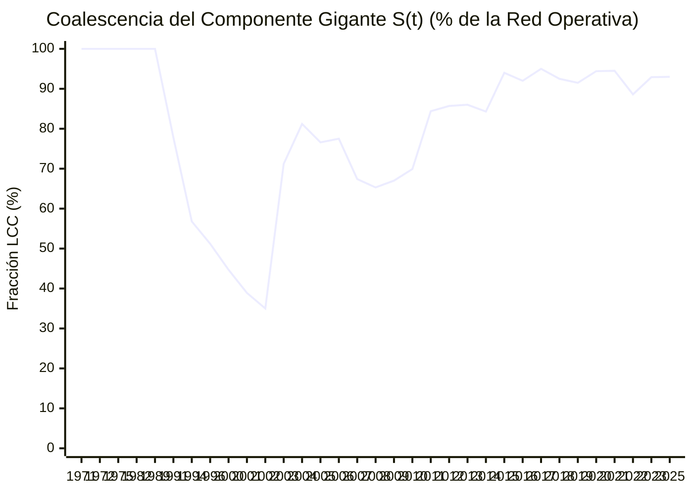

# Evolución Temporal $G(t)$, Transición de Fase de Molloy-Reed y Ráfagas de Goh-Barabási

> [!WARNING] Análisis exploratorio, no prueba de responsabilidad
> Este reporte aplica métricas de análisis de redes a los datos del vault. Sus resultados describen la estructura del grafo, no hechos: una cercanía, un agrupamiento o un par similar no indica que exista una relación, un acuerdo ni un delito. Los datos tienen calidades distintas (ver `monto_origen` y `estado_verificacion`) y pueden contener errores. Toda persona mencionada se presume inocente mientras no exista sentencia condenatoria firme. No citar estos resultados como prueba ni como acusación.

> [!IMPORTANT] Dinámica No Lineal de Redes y Coalescencia del Componente Gigante
> Esta vista reconstruye el grafo acumulado $G(t) = (V(t), E(t))$ desde `2001` hasta `2023` a medida que se activan cronológicamente los nexos transaccionales (`TRX`):
> 1. **Criterio de Percolación de Molloy-Reed ($\kappa(t) = \langle k^2 \rangle / \langle k \rangle > 2$)**: Determina en qué momento la red supera el umbral crítico $\kappa_c = 2.0$ y experimenta una **transición de fase hacia un régimen supercrítico macro-conectado**.
> 2. **Coeficiente de Ráfaga Temporal de Goh & Barabási ($B \in [-1, 1]$)**: Evalúa si las transacciones registradas ocurren de forma independiente o en **ráfagas sincronizadas ($B > 0$)** asociadas a ciclos electorales y presupuestarios.

## 1. Métricas Dinámicas e Inter-Transaccionales (2001–2023)

- **Coeficiente de Ráfaga Temporal de Goh-Barabási ($B$)**: **`+0.2775`**
  - *Diagnóstico Cronológico*: **Dinámica de Ráfagas Sincronizadas (*Burst-Driven Process*, $B > 0$: los desembolsos se concentran en ventanas electorales y cierres presupuestarios)**
- **Intervalo Medio entre Transacciones ($\mu_\tau$)**: `247.0 días` | **Desviación Estándar ($\sigma_\tau$)**: `436.7 días`
- **Parámetro de Molloy-Reed Actual ($\kappa(2023) = \langle k^2 \rangle / \langle k \rangle$)**: **`4.2413`** *(Supercrítico: $\kappa > 2.0$)*
- **Coalescencia del Componente Gigante ($S(2023)$)**: **`93.0%`** (`278` de `299` nodos unidos en un único macro-componente)

---

## 2. Serie Histórica Acumulada $G(t)$ y Transición de Fase (`2001 → 2023`)

| Año ($t$) | TRX Acum. | Nodos $|V(t)|$ | Aristas $|E(t)|$ | LCC $|V_{\text{LCC}}(t)|$ | Fracción Gigante $S(t)$ | Molloy-Reed $\kappa(t)$ | Monto Acumulado $\Phi(t)$ |
| :---: | :---: | :---: | :---: | :---: | :---: | :---: | :---: |
| **1971** | `1` | `6` | `7` | `6` | **`100.0%`** | `3.00` | `$0 CLP` |
| **1972** | `2` | `9` | `12` | `9` | **`100.0%`** | `3.42` | `$0 CLP` |
| **1975** | `3` | `11` | `17` | `11` | **`100.0%`** | `3.76` | `$0 CLP` |
| **1982** | `4` | `17` | `24` | `17` | **`100.0%`** | `3.58` | `$0 CLP` |
| **1989** | `5` | `21` | `31` | `21` | **`100.0%`** | `3.65` | `$2.950.000.000 CLP` |
| **1991** | `6` | `27` | `37` | `21` | **`77.8%`** | `3.54` | `$2.950.000.000 CLP` |
| **1994** | `8` | `37` | `46` | `21` | **`56.8%`** | `3.41` | `$107.530.000.000 CLP` |
| **1996** | `9` | `41` | `52` | `21` | **`51.2%`** | `3.42` | `$107.530.000.000 CLP` |
| **2000** | `10` | `47` | `58` | `21` | **`44.7%`** | `3.40` | `$107.530.000.000 CLP` |
| **2001** | `11` | `54` | `66` | `21` | **`38.9%`** | `3.35` | `$108.783.000.000 CLP` |
| **2002** | `12` | `60` | `73` | `21` | **`35.0%`** | `3.33` | `$108.803.000.000 CLP` |
| **2003** | `14` | `66` | `85` | `47` | **`71.2%`** | `3.40` | `$108.803.000.000 CLP` |
| **2004** | `15` | `69` | `91` | `56` | **`81.2%`** | `3.46` | `$124.603.000.000 CLP` |
| **2005** | `18` | `77` | `108` | `59` | **`76.6%`** | `3.63` | `$127.470.000.000 CLP` |
| **2006** | `19` | `80` | `114` | `62` | **`77.5%`** | `3.65` | `$132.770.000.000 CLP` |
| **2007** | `21` | `92` | `126` | `62` | **`67.4%`** | `3.59` | `$132.770.000.000 CLP` |
| **2008** | `22` | `95` | `131` | `62` | **`65.3%`** | `3.60` | `$132.770.000.000 CLP` |
| **2009** | `23` | `100` | `138` | `67` | **`67.0%`** | `3.61` | `$133.110.000.000 CLP` |
| **2010** | `27` | `113` | `163` | `79` | **`69.9%`** | `3.72` | `$209.526.500.000 CLP` |
| **2011** | `32` | `135` | `196` | `114` | **`84.4%`** | `3.79` | `$278.364.500.000 CLP` |
| **2012** | `35` | `147` | `215` | `126` | **`85.7%`** | `3.86` | `$287.967.500.000 CLP` |
| **2013** | `37` | `150` | `226` | `129` | **`86.0%`** | `4.03` | `$289.383.500.000 CLP` |
| **2014** | `39` | `159` | `236` | `134` | **`84.3%`** | `3.98` | `$295.538.530.792 CLP` |
| **2015** | `45` | `182` | `268` | `171` | **`94.0%`** | `3.98` | `$342.960.253.020 CLP` |
| **2016** | `51` | `201` | `299` | `185` | **`92.0%`** | `4.04` | `$421.309.181.218 CLP` |
| **2017** | `57` | `219` | `327` | `208` | **`95.0%`** | `4.04` | `$520.677.099.718 CLP` |
| **2018** | `59` | `227` | `338` | `210` | **`92.5%`** | `4.04` | `$520.802.099.718 CLP` |
| **2019** | `61` | `235` | `351` | `215` | **`91.5%`** | `4.07` | `$521.029.099.718 CLP` |
| **2020** | `65` | `250` | `373` | `236` | **`94.4%`** | `4.11` | `$596.581.099.718 CLP` |
| **2021** | `66` | `256` | `380` | `242` | **`94.5%`** | `4.10` | `$597.340.099.718 CLP` |
| **2022** | `74` | `280` | `425` | `248` | **`88.6%`** | `4.14` | `$601.069.734.718 CLP` |
| **2023** | `80` | `296` | `456` | `275` | **`92.9%`** | `4.24` | `$841.169.734.718 CLP` |
| **2025** | `81` | `299` | `460` | `278` | **`93.0%`** | `4.24` | `$841.204.734.718 CLP` |

---

## 3. Curva de Crecimiento del Componente Gigante $S(t)$ y Caudal Registrado

