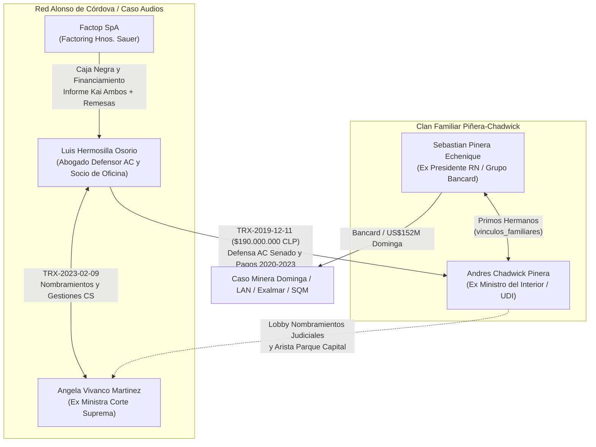

# Redes de Parentesco, Clanes Familiares y Puentes Dinásticos ($G_{\text{fam}}$)

> **Modelamiento Matemático de Parentesco en Grafos Multiplex**: En el estudio de captura del Estado y corrupción sistémica, los lazos de consanguinidad (padres, hijos, primos hermanos) y afinidad (cónyuges, suegros, yernos, cuñados) conforman una capa estructural independiente ($E_{\text{fam}}$) que se superpone a la red de transacciones financieras ($E_{\text{trx}}$) y militancias políticas ($E_{\text{pol}}$). Mediante el atributo YAML `vinculos_familiares` en el esquema `persona`, el motor de grafos cuantifica cómo los clanes familiares reducen la distancia geodésica ($\Delta d$) entre macro-causas judiciales y concentran flujos patrimoniales.

## 1. Resumen Ejecutivo de la Capa de Parentesco (`vinculos_familiares`)
- **Clanes Familiares / Dinásticos Modelados**: **3** componentes conexas familiares.
- **Sujetos Integrados en Redes de Parentesco Explícito**: **8** nodos de tipo `persona`.
- **Aristas de Parentesco Bidireccionales (`vinculos_familiares`)**: **7 pares familiares** (14 aristas dirigidas en el grafo).
- **Patrimonio Total Asociado a Clanes Familiares en Aristas Reificadas**: **`$191.154.000.000 CLP`** a través de **15 transacciones reificadas**.

---

## 2. El Triángulo Piñera – Chadwick – Hermosilla (Arista Caso Audios y Acusación Constitucional)

Uno de los casos paradigmáticos de acoplamiento entre **parentesco político-familiar** y **operadores extraprocesales** en la bóveda es la tríada conformada por [[Sebastian Pinera Echenique]], su primo hermano [[Andres Chadwick Pinera]] y el abogado penalista [[Luis Hermosilla Osorio]]:

1. **Consanguinidad y Poder Ejecutivo (`Clan Piñera–Chadwick`)**: [[Sebastian Pinera Echenique]] y [[Andres Chadwick Pinera]] son **primos hermanos** (la madre de Chadwick, Paulette Piñera Carvallo, era hermana de José Piñera Carvallo, padre del expresidente). Durante ambos gobiernos de Piñera (2010–2014 y 2018–2022), Chadwick ocupó el corazón político de La Moneda como Ministro Secretario General de Gobierno y Ministro del Interior y Seguridad Pública, mientras [[Luis Hermosilla Osorio]] actuó como asesor penal externo de Interior y abogado de confianza del oficialismo.
2. **Defensa en la Acusación Constitucional (`Diciembre de 2019`) financiada por [[Factop SpA]]**: Cuando [[Andres Chadwick Pinera]] enfrentó la Acusación Constitucional ante el [[Senado de la Republica de Chile]] (aprobada el 11 de diciembre de 2019 con inhabilitación por 5 años), su abogado defensor principal fue [[Luis Hermosilla Osorio]]. Los peritajes del [[Caso Audios]] demostraron que el informe en derecho del jurista alemán Kai Ambos utilizado en esa defensa parlamentaria fue pagado directamente con fondos del *factoring* [[Factop SpA]] de los hermanos Sauer.
3. **Comunidad de Oficina en Alonso de Córdova y Transferencias por `$190.000.000 CLP` (`2020–2023`)**: Tras salir del gobierno, [[Andres Chadwick Pinera]] compartió oficina privada con [[Luis Hermosilla Osorio]] en Alonso de Córdova 3788 (Vitacura) —el mismo lugar donde se grabó [[Audio-Reunion-Edificio-Alonso-2023]]—. Entre 2020 y 2023, Hermosilla transfirió más de **`$190.000.000 CLP`** a Chadwick con cargo a fondos provenientes de [[Factop SpA]] ([[TRX-2019-12-11-Defensa-AC-Transferencias-Factop-Hermosilla-Chadwick-01]]), período en que se investigan gestiones de [[Trafico de Influencias]] para destrabar el proyecto *Parque Capital* (Grupo Patio) y coordinaciones en nombramientos judiciales en la [[Corte Suprema de Chile]] junto a la exministra [[Angela Vivanco Martinez]] ([[TRX-2023-02-09-Gestion-Judicial-Hermosilla-Vivanco-01]]).

---

## 3. Catálogo Forense de Clanes Familiares y Concentración Patrimonial

| Clan Familiar / Dinástico | Tipo de Parentesco | Miembros (`persona`) | Macro-Causas Conectadas | N° TRX | Volumen Patrimonial Asociado (CLP) |
| :--- | :--- | :--- | :--- | :---: | ---: |
| **Clan Piñera–Chadwick (Eje Ejecutivo–UDI–Alonso de Córdova / Caso Audios)** | Consanguinidad colateral en 4° grado (Primos hermanos: hijos de hermanos Piñera Carvallo) | [[Andres Chadwick Pinera]], [[Sebastian Pinera Echenique]] | [[Caso Audios]], [[Caso Exalmar y Fideicomiso Ciego]], [[Caso LAN Informacion Privilegiada y Banco de Talca]], [[Caso Minera Dominga Pandora Papers]] | 5 | **$107.740.000.000** |
| **Clan Pinochet–Hiriart–Ponce Lerou (Eje Cívico-Militar, CEMA, Riggs y Sociedades Cascada/SQM)** | Matrimonio (Pinochet–Hiriart), filiación directa (Pinochet Hiriart) y afinidad en 1° grado (ex yerno Julio Ponce Lerou) | [[Augusto Pinochet Hiriart]], [[Augusto Pinochet Ugarte]], [[Julio Ponce Lerou]], [[Lucia Hiriart Rodriguez]] | [[Caso CEMA Chile]], [[Caso Cascadas]], [[Caso Operacion FUBELT Intervencion CIA y DINA]], [[Caso Panama Papers Chile]], [[Caso Pinocheques]], [[Caso Riggs]] | 8 | **$52.400.000.000** |
| **Clan Lavín–Barriga (Eje Holding Penta – Municipalidad de Maipú)** | Afinidad colateral extendida (vía Joaquín Lavín Infante, primo hermano de Carlos Eugenio Lavín y suegro de Cathy Barriga) | [[Carlos Eugenio Lavin Garcia-Huidobro]], [[Cathy Barriga Guerra]] | [[Caso Municipalidad de Maipu]], [[Caso Penta]] | 2 | **$31.014.000.000** |

### Detalle Estructural por Clan

#### 3.1. Clan Piñera–Chadwick (Eje Ejecutivo–UDI–Alonso de Córdova / Caso Audios)
- **Vínculo Genealógico / Afinidad**: Consanguinidad colateral en 4° grado (Primos hermanos: hijos de hermanos Piñera Carvallo).
- **Integrantes en la Bóveda**: [[Andres Chadwick Pinera]], [[Sebastian Pinera Echenique]].
- **Macro-Causas Acopladas (4)**: [[Caso Audios]], [[Caso Exalmar y Fideicomiso Ciego]], [[Caso LAN Informacion Privilegiada y Banco de Talca]], [[Caso Minera Dominga Pandora Papers]].
- **Aristas Reificadas Vinculadas (5)**: [[TRX-1982-08-28-Creditos-Relacionados-BancoDeTalca-Pinera-01]], [[TRX-2006-07-24-Compra-Acciones-Informacion-Privilegiada-LAN-01]], [[TRX-2010-12-10-Compraventa-Offshore-Dominga-Bancard-Delano-01]], [[TRX-2012-11-20-Inversion-Offshore-Bancard-Exalmar-LaHaya-01]], [[TRX-2019-12-11-Defensa-AC-Transferencias-Factop-Hermosilla-Chadwick-01]].
- **Volumen Financiero Consolidado**: **`$107.740.000.000 CLP`**.
- **Síntesis de Captura de Red**: Articula el poder presidencial y financiero del Grupo Bancard ([[Sebastian Pinera Echenique]]) con la conducción política de la [[Union Democrata Independiente]] y del Ministerio del Interior ([[Andres Chadwick Pinera]]). A través de la comunidad de oficina en Alonso de Córdova y la defensa en la Acusación Constitucional de 2019, conecta directamente al clan con el operador legal y penal [[Luis Hermosilla Osorio]], el factoring [[Factop SpA]] y la red de nombramientos en la [[Corte Suprema de Chile]] ([[Angela Vivanco Martinez]]).

#### 3.2. Clan Pinochet–Hiriart–Ponce Lerou (Eje Cívico-Militar, CEMA, Riggs y Sociedades Cascada/SQM)
- **Vínculo Genealógico / Afinidad**: Matrimonio (Pinochet–Hiriart), filiación directa (Pinochet Hiriart) y afinidad en 1° grado (ex yerno Julio Ponce Lerou).
- **Integrantes en la Bóveda**: [[Augusto Pinochet Hiriart]], [[Augusto Pinochet Ugarte]], [[Julio Ponce Lerou]], [[Lucia Hiriart Rodriguez]].
- **Macro-Causas Acopladas (6)**: [[Caso CEMA Chile]], [[Caso Cascadas]], [[Caso Operacion FUBELT Intervencion CIA y DINA]], [[Caso Panama Papers Chile]], [[Caso Pinocheques]], [[Caso Riggs]].
- **Aristas Reificadas Vinculadas (8)**: [[TRX-1972-10-12-Fondos-Desestabilizacion-Gremios-ParoCamioneros-CIA-01]], [[TRX-1975-08-15-Pagos-CIA-Entrenamiento-SOA-DINA-Contreras-01]], [[TRX-1989-01-10-Emision-Pinocheques-Ejercito-Valmoval-01]], [[TRX-2004-07-14-Desvio-Gastos-Reservados-Riggs-Pinochet-01]], [[TRX-2005-08-10-Evasion-Tributaria-Cuentas-Riggs-SII-01]], [[TRX-2011-12-19-Operaciones-Bursatiles-Cascadas-SQM-01]], [[TRX-2016-04-15-Cruce-Offshore-MossackFonseca-Riggs-Pinochet-01]], [[TRX-2016-08-12-Enajenacion-Inmuebles-Fiscales-CEMAChile-01]].
- **Volumen Financiero Consolidado**: **`$52.400.000.000 CLP`**.
- **Síntesis de Captura de Red**: Conecta la captura patrimonial directa de fondos reservados y bienes fiscales durante la dictadura ([[Caso Pinocheques]], [[Caso Riggs]] y [[Caso CEMA Chile]]) con el control post-privatización de [[SQM SA]] y las [[Sociedad de Inversiones Pampa Calichera SA|Sociedades Cascada]] ([[Caso Cascadas]]), desde donde a su vez se financió transversalmente a la élite partidaria entre 2009 y 2015 ([[Caso SQM]]).

#### 3.3. Clan Lavín–Barriga (Eje Holding Penta – Municipalidad de Maipú)
- **Vínculo Genealógico / Afinidad**: Afinidad colateral extendida (vía Joaquín Lavín Infante, primo hermano de Carlos Eugenio Lavín y suegro de Cathy Barriga).
- **Integrantes en la Bóveda**: [[Carlos Eugenio Lavin Garcia-Huidobro]], [[Cathy Barriga Guerra]].
- **Macro-Causas Acopladas (2)**: [[Caso Municipalidad de Maipu]], [[Caso Penta]].
- **Aristas Reificadas Vinculadas (2)**: [[TRX-2011-03-10-Pagos-Penta-Wagner-01]], [[TRX-2020-12-15-Deficit-Maipu-Certificados-01]].
- **Volumen Financiero Consolidado**: **`$31.014.000.000 CLP`**.
- **Síntesis de Captura de Red**: Vincula a la cúpula financiera fundadora de [[Empresas Penta SA]] ([[Carlos Eugenio Lavin Garcia-Huidobro]], condenado en [[Caso Penta]]) con la administración alcaldicia de la [[Municipalidad de Maipu]] ([[Cathy Barriga Guerra]], formalizada por [[Fraude al Fisco]] en [[Caso Municipalidad de Maipu]]).

---

## 4. Reducción de Distancia Geodésica ($\Delta d$) por Atajos de Parentesco

Para medir el impacto topológico de los vínculos familiares, comparamos la distancia geodésica más corta $d_{G}(u, v)$ en el grafo completo versus $d_{G \setminus E_{\text{fam}}}(u, v)$ cuando se remueven las aristas `vinculos_familiares`:

| Nodo Origen ($u$) | Nodo Destino ($v$) | $d(u,v)$ Sin Parentesco | $d(u,v)$ Con Parentesco | Reducción $\Delta d$ | Ruta Geodésica Mínima con Parentesco |
| :--- | :--- | :---: | :---: | :---: | :--- |
| [[Sebastian Pinera Echenique]] | [[Luis Hermosilla Osorio]] | `4` | **`3`** | **-1 saltos** | [[Sebastian Pinera Echenique]] → [[Andres Chadwick Pinera]] → [[TRX-2019-12-11-Defensa-AC-Transferencias-Factop-Hermosilla-Chadwick-01]] → [[Luis Hermosilla Osorio]] |
| [[Bancard Inversiones Ltda]] | [[Factop SpA]] | `4` | **`4`** | **0 saltos** | [[Bancard Inversiones Ltda]] → [[Sebastian Pinera Echenique]] → [[Andres Chadwick Pinera]] → [[TRX-2019-12-11-Defensa-AC-Transferencias-Factop-Hermosilla-Chadwick-01]] → [[Factop SpA]] |
| [[Caso Minera Dominga Pandora Papers]] | [[Caso Audios]] | `2` | **`2`** | **0 saltos** | [[Caso Minera Dominga Pandora Papers]] → [[Cohecho]] → [[Caso Audios]] |
| [[Augusto Pinochet Ugarte]] | [[SQM SA]] | `5` | **`3`** | **-2 saltos** | [[Augusto Pinochet Ugarte]] → [[Julio Ponce Lerou]] → [[TRX-2011-12-19-Operaciones-Bursatiles-Cascadas-SQM-01]] → [[SQM SA]] |
| [[Caso Riggs]] | [[Caso Cascadas]] | `5` | **`5`** | **0 saltos** | [[Caso Riggs]] → [[Sentencia-Corte-Suprema-CasoRiggs-2018]] → [[Corte Suprema de Chile]] → [[TRX-1982-08-28-Creditos-Relacionados-BancoDeTalca-Pinera-01]] → [[Negociacion Incompatible]] → [[Caso Cascadas]] |
| [[Caso Pinocheques]] | [[Caso CEMA Chile]] | `5` | **`5`** | **0 saltos** | [[Caso Pinocheques]] → [[TRX-1989-01-10-Emision-Pinocheques-Ejercito-Valmoval-01]] → [[Augusto Pinochet Hiriart]] → [[Lucia Hiriart Rodriguez]] → [[TRX-2016-08-12-Enajenacion-Inmuebles-Fiscales-CEMAChile-01]] → [[Caso CEMA Chile]] |
| [[Caso Penta]] | [[Caso Municipalidad de Maipu]] | `5` | **`5`** | **0 saltos** | [[Caso Penta]] → [[TRX-2011-03-10-Pagos-Penta-Wagner-01]] → [[Carlos Eugenio Lavin Garcia-Huidobro]] → [[Cathy Barriga Guerra]] → [[TRX-2020-12-15-Deficit-Maipu-Certificados-01]] → [[Caso Municipalidad de Maipu]] |

---

## 5. Otros Nexos de Parentesco e Influencia Familiar Documentados en Causas

Además de los clanes que conectan múltiples nodos `persona` entre distintas causas, la bóveda registra aristas donde el parentesco opera al interior de una misma causa o sociedad vehículo:
- **[[Caso Caval]] ([[Natalia Compagnon Soto]])**: Socia del 50% de [[Exportadora y de Gestion Caval Ltda]], cónyuge de Sebastián Dávalos Bachelet y nuera de la entonces Presidenta de la República Michelle Bachelet Jeria, vínculo familiar decisivo en la reunión privada con la vicepresidencia de [[Banco de Chile]] para obtener el crédito de `$6.500.000.000 CLP` ([[TRX-2013-11-06-Reunion-Luksic-Compagnon-01]] y [[TRX-2014-02-07-Credito-BancoDeChile-Caval-01]]).
- **[[Caso Pinocheques]] y [[Caso Riggs]] (Sucesión Pinochet–Hiriart)**: Utilización de cuentas mancomunadas, pasaportes ideológicamente falsos y sociedades *offshore* familiares en [[Riggs Bank y Sociedades Offshore Ashburton]] para distribuir fondos reservados entre el grupo familiar directo de [[Augusto Pinochet Ugarte]], [[Lucia Hiriart Rodriguez]] y [[Augusto Pinochet Hiriart]].
