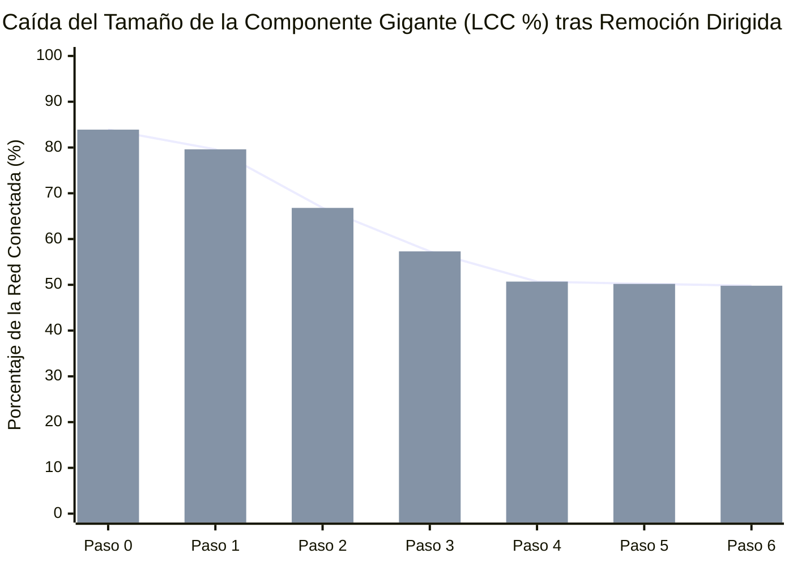

# Robustez de la Red ante la Eliminación de Nodos (*Key Player Problem*)

> [!WARNING] Análisis exploratorio, no prueba de responsabilidad
> Este reporte aplica métricas de análisis de redes a los datos del vault. Sus resultados describen la estructura del grafo, no hechos: una cercanía, un agrupamiento o un par similar no indica que exista una relación, un acuerdo ni un delito. Los datos tienen calidades distintas (ver `monto_origen` y `estado_verificacion`) y pueden contener errores. Toda persona mencionada se presume inocente mientras no exista sentencia condenatoria firme. No citar estos resultados como prueba ni como acusación.
>
> La simulación elimina nodos del grafo para medir su conectividad. Es un ejercicio matemático y no describe ni sugiere acciones sobre personas reales.

Modelamiento topológico basado en el protocolo de **percolación dirigida adaptativa** (Borgatti, 2006): evalúa cómo se fragmenta la Componente Gigante (`LCC`) de la red al neutralizar secuencialmente los actores con mayor centralidad de intermediación recalculada en cada paso.

---

## 1. Curva de Degradación de la Componente Gigante (`LCC %`)

---

## 2. Secuencia Óptima de Neutralización de Nodos Puente

| Paso ($k$) | Nodo Neutralizado / Removido | Tipo de Actor | Islas Resultantes (Componentes) | Nodos en Mayor Componente (`LCC`) | Cohesión Residual (`LCC %`) |
| :---: | :--- | :--- | :---: | :---: | ---: |
| **0** | Estado Inicial (Sin remoción) | `—` | **19** | 177 de 211 | **83.9%** |
| **1** | [[Corte Suprema de Chile]] | `entidad_publica` | **20** | 168 de 211 | **79.6%** |
| **2** | [[Union Democrata Independiente]] | `partido_politico` | **22** | 141 de 211 | **66.8%** |
| **3** | [[Renovacion Nacional]] | `partido_politico` | **26** | 121 de 211 | **57.3%** |
| **4** | [[Servicio Impuestos Internos]] | `entidad_publica` | **29** | 107 de 211 | **50.7%** |
| **5** | [[Sebastian Pinera Echenique]] | `persona` | **29** | 106 de 211 | **50.2%** |
| **6** | [[Bancard Inversiones Ltda]] | `entidad_privada` | **29** | 105 de 211 | **49.8%** |
