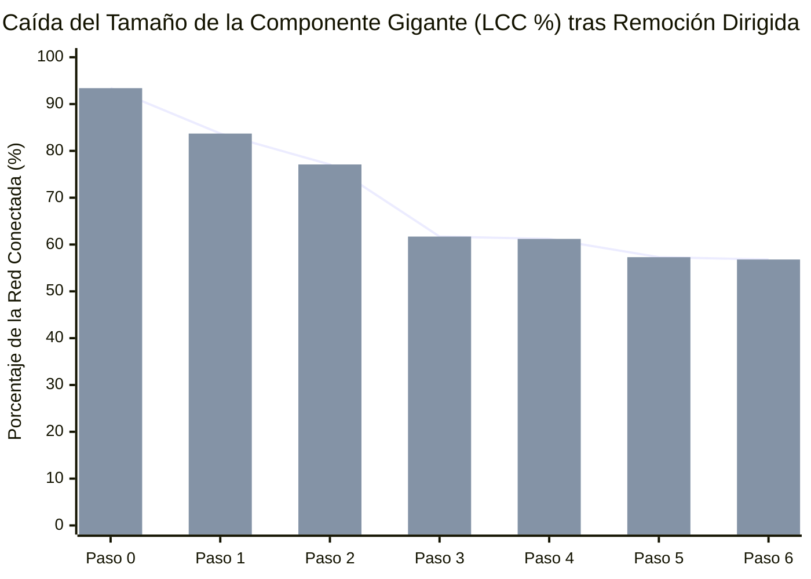

# Simulación Forense de Desarticulación de Red (*Key Player Problem*)

Modelamiento topológico basado en el protocolo de **percolación dirigida adaptativa** (Borgatti, 2006): evalúa cómo se fragmenta la Componente Gigante (`LCC`) de la red de corrupción al neutralizar secuencialmente los actores con mayor centralidad de intermediación recalculada en cada paso.

---

## 1. Curva de Degradación de la Componente Gigante (`LCC %`)

---

## 2. Secuencia Óptima de Neutralización de Nodos Puente

| Paso ($k$) | Nodo Neutralizado / Removido | Tipo de Actor | Islas Resultantes (Componentes) | Nodos en Mayor Componente (`LCC`) | Cohesión Residual (`LCC %`) |
| :---: | :--- | :--- | :---: | :---: | ---: |
| **0** | Estado Inicial (Sin remoción) | `—` | **11** | 212 de 227 | **93.4%** |
| **1** | [[Servicio Impuestos Internos]] | `entidad_publica` | **14** | 190 de 227 | **83.7%** |
| **2** | [[Corte Suprema de Chile]] | `entidad_publica` | **18** | 175 de 227 | **77.1%** |
| **3** | [[Union Democrata Independiente]] | `partido_politico` | **21** | 140 de 227 | **61.7%** |
| **4** | [[Sebastian Pinera Echenique]] | `persona` | **21** | 139 de 227 | **61.2%** |
| **5** | [[Renovacion Nacional]] | `partido_politico` | **23** | 130 de 227 | **57.3%** |
| **6** | [[Bancard Inversiones Ltda]] | `entidad_privada` | **23** | 129 de 227 | **56.8%** |
