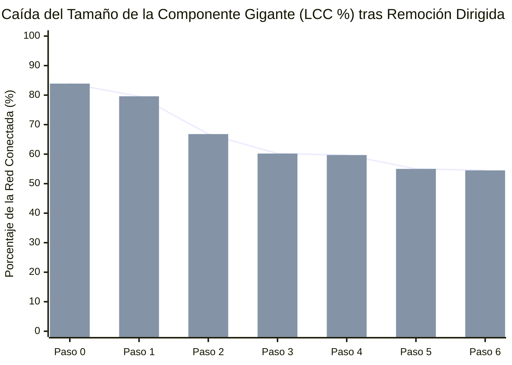

# Simulación Forense de Desarticulación de Red (*Key Player Problem*)

Modelamiento topológico basado en el protocolo de **percolación dirigida adaptativa** (Borgatti, 2006): evalúa cómo se fragmenta la Componente Gigante (`LCC`) de la red de corrupción al neutralizar secuencialmente los actores con mayor centralidad de intermediación recalculada en cada paso.

---

## 1. Curva de Degradación de la Componente Gigante (`LCC %`)

---

## 2. Secuencia Óptima de Neutralización de Nodos Puente

| Paso ($k$) | Nodo Neutralizado / Removido | Tipo de Actor | Islas Resultantes (Componentes) | Nodos en Mayor Componente (`LCC`) | Cohesión Residual (`LCC %`) |
| :---: | :--- | :--- | :---: | :---: | ---: |
| **0** | Estado Inicial (Sin remoción) | `—` | **19** | 177 de 211 | **83.9%** |
| **1** | [[Corte Suprema de Chile]] | `entidad_publica` | **20** | 168 de 211 | **79.6%** |
| **2** | [[Union Democrata Independiente]] | `partido_politico` | **22** | 141 de 211 | **66.8%** |
| **3** | [[Servicio Impuestos Internos]] | `entidad_publica` | **25** | 127 de 211 | **60.2%** |
| **4** | [[Sebastian Pinera Echenique]] | `persona` | **25** | 126 de 211 | **59.7%** |
| **5** | [[Renovacion Nacional]] | `partido_politico` | **28** | 116 de 211 | **55.0%** |
| **6** | [[Bancard Inversiones Ltda]] | `entidad_privada` | **28** | 115 de 211 | **54.5%** |
