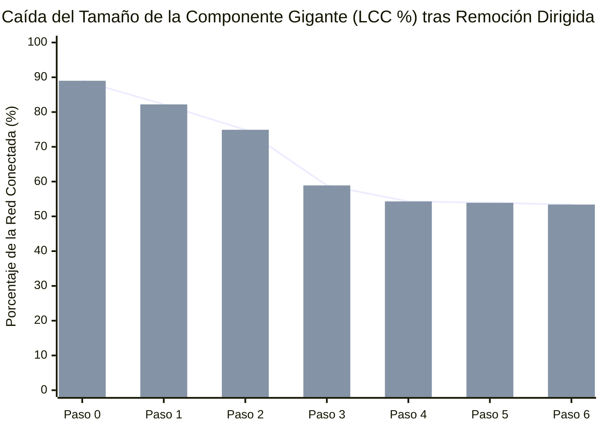

# Simulación Forense de Desarticulación de Red (*Key Player Problem*)

Modelamiento topológico basado en el protocolo de **percolación dirigida adaptativa** (Borgatti, 2006): evalúa cómo se fragmenta la Componente Gigante (`LCC`) de la red de corrupción al neutralizar secuencialmente los actores con mayor centralidad de intermediación recalculada en cada paso.

---

## 1. Curva de Degradación de la Componente Gigante (`LCC %`)

---

## 2. Secuencia Óptima de Neutralización de Nodos Puente

| Paso ($k$) | Nodo Neutralizado / Removido | Tipo de Actor | Islas Resultantes (Componentes) | Nodos en Mayor Componente (`LCC`) | Cohesión Residual (`LCC %`) |
| :---: | :--- | :--- | :---: | :---: | ---: |
| **0** | Estado Inicial (Sin remoción) | `—` | **16** | 195 de 219 | **89.0%** |
| **1** | [[Corte Suprema de Chile]] | `entidad_publica` | **20** | 180 de 219 | **82.2%** |
| **2** | [[Servicio Impuestos Internos]] | `entidad_publica` | **23** | 164 de 219 | **74.9%** |
| **3** | [[Union Democrata Independiente]] | `partido_politico` | **26** | 129 de 219 | **58.9%** |
| **4** | [[Renovacion Nacional]] | `partido_politico` | **29** | 119 de 219 | **54.3%** |
| **5** | [[Sebastian Pinera Echenique]] | `persona` | **29** | 118 de 219 | **53.9%** |
| **6** | [[Bancard Inversiones Ltda]] | `entidad_privada` | **29** | 117 de 219 | **53.4%** |
