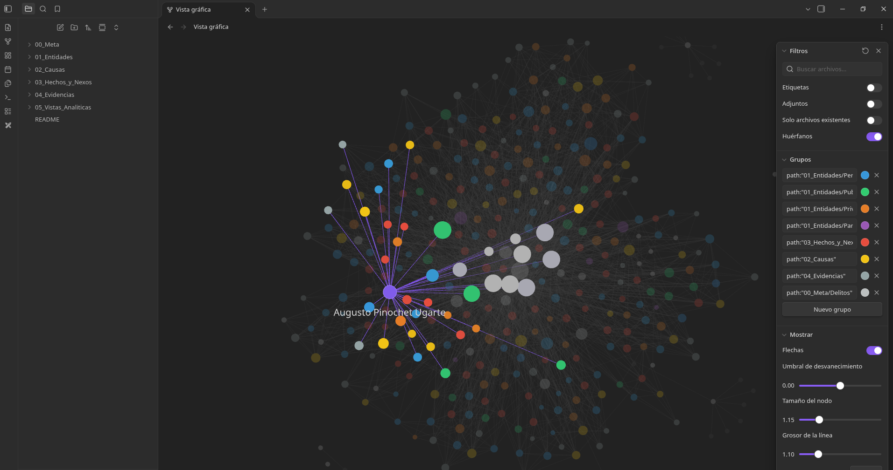
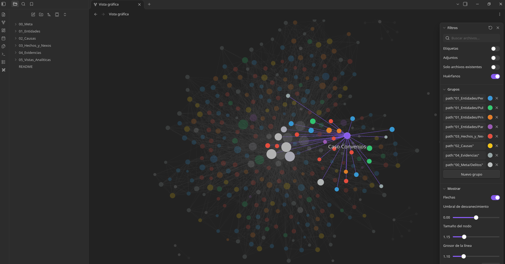
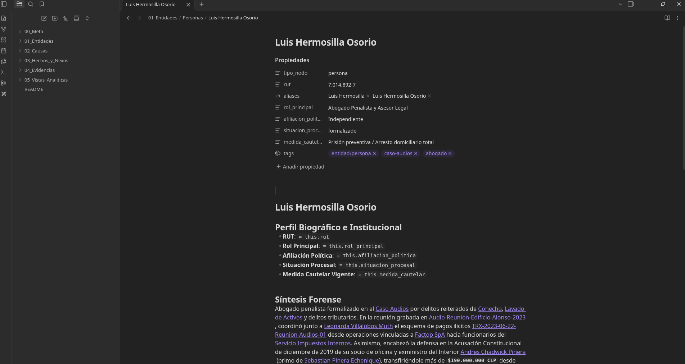
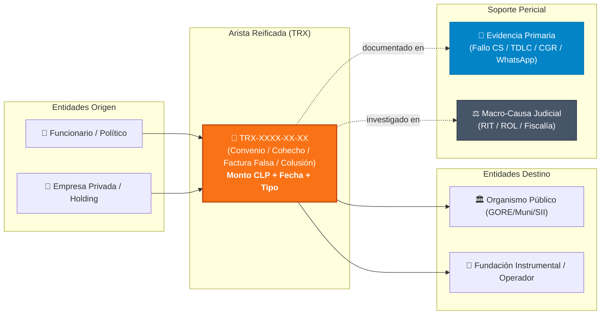

# 🇨🇱 FTM-Chile | Follow The Money Chile
### Bóveda OSINT, Grafos Reificados y Auditoría Forense de Redes de Poder y Corrupción

<p align="center">
  
  
  
  
  
  
</p>

---

## ⚖️ Descargo de Responsabilidad Legal, Presunción de Inocencia y Fe de Erratas

> [!CAUTION]
> ### Declaración de Finalidad Pública, Científica y Restricción de Imputaciones
> 
> 1. **Finalidad Exclusivamente de Investigación y Docencia:** Este repositorio es un proyecto de recopilación académica, periodismo de datos y análisis de redes complejas basado íntegramente en **Fuentes Abiertas (OSINT - *Open Source Intelligence*)**. No constituye un dictamen judicial, una acusación fiscal ni una sentencia de culpabilidad.
> 
> 2. **Posibilidad de Errores e Imprecisiones:** Toda la información aquí indexada procede de fuentes públicas secundarias y primarias (expedientes judiciales electrónicos, resoluciones del Poder Judicial, fallos del TDLC, informes de la Contraloría General de la República, requerimientos de la FNE y reportajes de investigación periodística formal). En virtud del volumen y la dinámica constante de las causas judiciales, **la información recopilada podría contener errores involuntarios, transcripciones inexactas, omisiones o desactualizaciones de estado procesal**.
> 
> 3. **Ausencia Absoluta de Ánimo de Injuria (*Animus Iniuriandi*):** Bajo ninguna circunstancia este proyecto tiene como propósito vulnerar la honra, dignidad, vida privada ni reputación de ninguna persona natural o jurídica mencionada. La inclusión de un individuo o entidad en el grafo responde a su aparición documental en un expediente, hito noticioso, resolución administrativa o peritaje de dominio público, respetando escrupulosamente el derecho a la información pública sobre materias de interés nacional.
> 
> 4. **Garantía Constitucional de Presunción de Inocencia:** En conformidad con el artículo 19 N° 3 de la Constitución Política de la República y el artículo 4° del Código Procesal Penal de Chile, **toda persona mencionada en calidad de investigada, imputada o querellada se presume inocente mientras no exista una sentencia judicial condenatoria firme y ejecutoriada en su contra**. Las personas con medidas cautelares o formalizaciones no son culpables hasta que un tribunal de juicio oral así lo declare.
> 
> 5. **Protocolo Abierto de Rectificación y Aclaraciones:** Si usted es una persona mencionada o representante de una entidad y considera que algún dato aquí expuesto es inexacto, erróneo, está desactualizado o requiere aclaración jurídica (por ejemplo, sobreseimiento definitivo, absolución o rectificación documental), solicitamos abrir un *Issue* en este repositorio o enviar una comunicación formal para proceder a la corrección o retiro inmediato del registro tras la verificación documental correspondiente.
> 
> 6. **Independencia, Ausencia de Patrocinio y Falta de Certificación Oficial:** Este proyecto es una iniciativa técnica, comunitaria y ciudadana de código abierto con fines de transparencia. **No cuenta con patrocinio, financiamiento, subvención, afiliación ni respaldo oficial de ningún partido político, grupo empresarial, órgano del Estado, ONG, universidad ni institución nacional o extranjera**. Asimismo, los cálculos, modelos de grafos y visualizaciones no constituyen una auditoría contable colegiada, peritaje judicial acreditado ni certificación oficial por parte de organismos fiscalizadores del Estado de Chile.

---

## 🖥️ Muestra Visual del Grafo en Obsidian

El repositorio está configurado de forma nativa para que Obsidian aplique automáticamente la paleta cromática forense, los filtros por tipo de nodo y la jerarquía de conexiones:

### 1. Vista de Grafo Global y Detección de Comunidades
Visualización completa de la red relacional en Obsidian, con agrupación por colores y focalización interactiva en nodos centrales y causas históricas:

<p align="center">
  
</p>

### 2. Vista de Clusters Operativos (Ejemplo: Caso Convenios)
Aislamiento topológico de conglomerados de fundaciones instrumentales, seremis y transferencias directas:

<p align="center">
  
</p>

### 3. Ficha Pericial Estructurada (Ejemplo: Caso Audios / Luis Hermosilla)
Cada entidad cuenta con metadatos YAML rigurosos, estado procesal, validación de RUT con Módulo 11 y tablas dinámicas DataviewJS de transferencias y vínculos:

<p align="center">
  
</p>

---

## 🧭 Cómo Usar e Investigar en este Vault con Obsidian

### Paso 1: Clonar el Repositorio
```bash
git clone https://github.com/0kamir/ftm-chile.git
```

### Paso 2: Abrir la Bóveda en Obsidian
1. Inicia **Obsidian**.
2. En la pantalla de bienvenida (o en el menú de bóvedas), haz clic en **`Abrir carpeta como bóveda (Open folder as vault)`**.
3. Selecciona la carpeta local del proyecto `ftm-chile`.

### Paso 3: Activar el Plugin Dataview (Imprescindible para las tablas contables)
1. En Obsidian, ve a **`Ajustes (Settings) ⚙️ → Plugins de la comunidad (Community plugins)`**.
2. Haz clic en **`Activar plugins de la comunidad`**.
3. Instala y activa **Dataview**.
4. En la configuración de **Dataview**, asegúrate de activar:
   - ✅ **`Enable JavaScript Queries`**
   - ✅ **`Enable Inline Queries`**
   - ✅ **`Enable Inline JavaScript Queries`**
   *(Esto permite que las tablas de transacciones, sumatorias en CLP y cruces de causas se actualicen en tiempo real).*

### Paso 4: Navegar el Grafo sin Saturación Visual (Técnica de Grafo Local a Profundidad 2)
Dado que el grafo contiene cientos de nodos y aristas, la inspección pericial recomendada es el **Grafo Local a Profundidad 2**:
1. Abre la nota de cualquier entidad o causa (ej. `Luis Hermosilla Osorio.md`, `Caso Colusion de los Pollos.md` o `Democracia Viva.md`).
2. Presiona `Ctrl+P` (o `Cmd+P` en macOS) y escribe **`Vista de grafo: Abrir grafo local`** (*Graph view: Open local graph*).
3. En el panel de **Filtros (`Filters`)** a la derecha, ajusta el deslizador **`Profundidad (Depth)` en `2`**:
   - **Profundidad 1 (`Depth = 1`)**: Muestra los nodos de transacción intermedios (`Actor ↔ Nexo TRX`).
   - **Profundidad 2 (`Depth = 2`)**: Conecta la operación completa (`Actor Origen ↔ TRX ↔ Actor Destino + Causa + Evidencia Documental`), permitiendo aislar la cadena de custodia legal sin ruido visual.

### Paso 5: Colores y Filtros Preconfigurados
El archivo `.obsidian/graph.json` ya viene configurado con la paleta pericial:
- 🔵 **Azul**: Personas naturales / Sujetos de interés (`01_Entidades/Personas/`)
- 🟢 **Verde**: Órganos del Estado e Instituciones Públicas (`01_Entidades/Publicas/`)
- 🟠 **Naranja**: Empresas privadas, holdings y fundaciones (`01_Entidades/Privadas/`)
- 🟣 **Púrpura**: Partidos y colectividades políticas (`01_Entidades/Partidos/`)
- 🔴 **Rojo**: Aristas reificadas y transacciones (`03_Hechos_y_Nexos/`)
- 🟡 **Amarillo**: Macro-Causas judiciales y expedientes (`02_Causas/`)
- ⚪ **Gris**: Evidencias primarias y sentencias (`04_Evidencias/`)

---

## 🔍 Arquitectura y Metodología de Datos (FollowTheMoney & ICIJ)

La limitación fundamental de los grafos tradicionales es que representan relaciones complejas como líneas simples (`Actor A ➔ Actor B`), perdiendo los atributos del hecho. **FTM-Chile** implementa **aristas reificadas**:



Cada transacción o reunión constituye una nota independiente con metadatos contables (`monto_clp`, `fecha`, `delito_imputado`, `firmante_origen`, `firmante_destino`, `evidencia_soporte`), exportable directamente a modelos de inteligencia financiera.

---

## 📊 Métricas Consolidadas del Vault

| Métrica Pericial | Valor Auditado | Verificación |
| :--- | :---: | :--- |
| **Notas Indexadas en Markdown** | **327** | Esquema estricto con metadatos YAML |
| **RUTs Chilenos Validados** | **62** | RUT de empresas y organismos (Módulo 11); no se publican RUT de personas |
| **Aristas Reificadas (`TRX`)** | **65** | Flujos transaccionales y nexos documentados |
| **Macro-Causas Judiciales y Carteles** | **32** | Causas activas y ejecutoriadas |
| **Monto Financiero Consolidado** | **$669.122.093.990 CLP** | Auditoría contable automatizada |
| **Batería de Pruebas Unitarias** | **24 / 24 OK** | `pytest` / `unittest` en entorno continuo |

---

## ⚖️ Catálogo de Macro-Causas Indexadas (32 Casos)

<details>
<summary><b>1. Carteles y Colusiones de Libre Competencia</b> (Click para desplegar)</summary>

- **Caso Colusión del Papel Tissue (Cartel del Confort)**: TDLC Rol C-299-15. Acuerdos de cuotas de mercado entre CMPC y SCA Chile (PISA) durante 15 años, con compensación universal histórica de $97.500 millones de pesos a los consumidores vía BancoEstado/SERNAC.
- **Caso Colusión de las Farmacias**: TDLC Rol C-184-08. Fijación coordinada de precios de 222 medicamentos sensibles entre FASA, Cruz Verde y Salcobrand, con compensación civil a consumidores vulnerables.
- **Caso Colusión de los Pollos**: TDLC Rol C-236-11. Asignación de cuotas de producción avícola entre Agrosuper, Ariztía y Don Pollo, coordinada por la Asociación de Productores Avícolas (APA). Sentencia de la Corte Suprema con multas de US$ 60 millones y disolución forzada de la APA.
</details>

<details>
<summary><b>2. Megafraudes Tributarios y Económicos</b> (Click para desplegar)</summary>

- **Operación Tributos (Megafraude de los $240 Mil Millones)**: RIT 13745-2023. La mayor red criminal de fraude tributario de Chile: 7 clanes delictivos (Pavez, Galaz, Barraza, Croxatto) formalizados por la emisión masiva de más de 100.000 facturas falsas y devolución fraudulenta de IVA exportador.
- **Caso Audios / Factop**: RIT 6112-2024. Cohecho, lavado de activos y tráfico de influencias destapado tras la filtración del audio de Luis Hermosilla, Leonarda Villalobos y Daniel Sauer.
- **Caso Cascadas**: Operaciones de manipulación bursátil y transacciones ficticias en las sociedades matrices de SQM controladas por Julio Ponce Lerou.
- **Caso La Polar**: Reprogramaciones unilaterales fraudulentas de cientos de miles de clientes morosos para inflar artificialmente balances financieros.
</details>

<details>
<summary><b>3. Corrupción Política y Financiamiento Ilegal</b> (Click para desplegar)</summary>

- **Caso Convenios / Fundaciones**: Desvío de fondos de ministerios y gobiernos regionales hacia fundaciones recién creadas (Democracia Viva, ProCultura, Urbanismo Social).
- **Caso Penta**: Emisión sistemática de boletas de honorarios ideológicamente falsas para financiar campañas políticas y pagar sobresueldos.
- **Caso SQM**: Financiamiento transversal ilícito de partidos y candidaturas mediante boletas falsas a la Sociedad Química y Minera de Chile.
- **Caso Corpesca**: Condena por cohecho y sobornos pagados por la pesquera al senador Jaime Orpis y la diputada Marta Isasi durante la tramitación de la Ley de Pesca.
- **Caso Caval**: Tráfico de influencias y uso de información privilegiada en la compraventa de terrenos agrícolas con cambio de uso de suelo en Machalí.
- **Caso MOP-Gate**: Desvío de fondos públicos y sobresueldos en el Ministerio de Obras Públicas a través de contratos de consultoría falsos con la empresa GATE.
</details>

<details>
<summary><b>4. Malversación en Fuerzas Armadas y de Orden</b> (Click para desplegar)</summary>

- **Caso Pacogate (Fraude en Carabineros)**: Malversación de más de $28.300 millones desde la Dirección de Finanzas de Carabineros a través de cuentas puente y comisiones.
- **Caso Milicogate (Fraude en el Ejército)**: Desvío millonario de fondos de la Ley Reservada del Cobre mediante facturas falsas por servicios de armamento inexistentes.
- **Operación Huracán**: Montaje policial de la Unidad de Inteligencia Operativa Especializada (UIOE) de Carabineros mediante software espía ficticio ("Antorcha") e implantación de chats falsos.
</details>

<details>
<summary><b>5. Corrupción Municipal, Injerencia Digital y Asignaciones</b> (Click para desplegar)</summary>

- **Caso Vitacura**: Mecanismo de desvío sistemático de dinero en efectivo desde los programas "Vitadeportes" y "Vitadesarrollo" hacia el despacho del alcalde Raúl Torrealba.
- **Caso Maipú**: Malversación de caudales públicos y fraude al fisco por más de $31.000 millones durante la administración de Cathy Barriga.
- **Caso Operaciones Digitales e Injerencia Electoral**: Indagatoria penal por el uso de granjas de bots, financiamiento no reportado al Servel y desinformación digital (Fernando Cerimedo / Numen SpA / registro en sede de Renovación Nacional).
- **Caso Asignaciones Parlamentarias y "Cuota Flores"**: Diligencias judiciales de la URAC y OS9 por presunta retención de parte de las remuneraciones en efectivo a asesores del Congreso, y arista conexa de vulneración a la intimidad.
</details>

---

## 🧮 Motor Analítico y Algoritmos Implementados

El repositorio cuenta con una suite en Python (`00_Meta/Scripts/`) que procesa la topología de la red mediante modelos matemáticos avanzados:

1. **Resistencia Efectiva y Centralidad de Kirchhoff** (`effective_resistance.py`): Modela la red de corrupción como un circuito eléctrico resistivo para identificar qué nodos conectan comunidades críticas sin rutas alternas.
2. **Partición Espectral y Vector de Fiedler** (`spectral_analysis.py`): Descomposición del Laplaciano de la red para aislar subgrafos independientes y calcular la rigidez algebraica.
3. **Agujeros Estructurales y Coeficiente de Burt** (`kcore_and_assortativity.py`): Mide la restricción estructural de actores que ejercen de intermediarios (*gatekeepers*) entre el sector privado y el Estado.
4. **Detección de Comunidades Louvain** (`community_detection.py`): Agrupación no supervisada de células operativas ($Q > 0.80$).
5. **Auditoría Estadística de Benford** (`benford_forensic.py`): Test de la Ley de Benford sobre el primer dígito y detector de anomalías por redondeo forzado en montos defraudados.
6. **Simulación de Percolación y Resiliencia** (`percolation_analysis.py`): Remoción secuencial de actores clave para predecir el colapso del componente gigante de la red (*LCC*).
7. **Corte Mínimo y Flujo Máximo** (`financial_flow_cut.py`): Cálculo del cuello de botella financiero mediante el algoritmo de Ford-Fulkerson / Edmonds-Karp.
8. **Predicción de Vínculos Ocultos** (`link_prediction.py`): Índice de Adamic-Adar y Resource Allocation para estimar nexos de coordinación no documentados explícitamente.

---

## 🚀 Automatización con `Makefile`

Para recomputar todas las métricas, regenerar los reportes analíticos y ejecutar la batería de pruebas:

```bash
# Validar integridad y ejecutar todos los analizadores
make all

# O ejecutar tareas específicas:
make validate    # Valida sintaxis YAML y algoritmo Módulo 11 en RUTs
make test        # Corre los 24 tests unitarios de integridad
make web         # Genera el visor HTML5 autónomo
```

---

## 📦 Formatos de Exportación para Inteligencia Externa

El directorio [`05_Vistas_Analiticas/Exportaciones/`](05_Vistas_Analiticas/Exportaciones/) contiene sincronizaciones continuas listas para importar en herramientas periciales:

- **Gephi / Cytoscape**: `red_corrupcion_chile.graphml`
- **Neo4j / Memgraph (ICIJ Standard)**: `icij_neo4j_import.cypher`
- **OCCRP Aleph**: `aleph_entities.ftm.jsonl` (formato FollowTheMoney)
- **Web Semántica**: `red_corrupcion_chile.jsonld`
- **Graphviz**: `red_corrupcion_chile.dot`
- **Planillas Tabulares**: `peritaje_entidades.csv`, `peritaje_imputados.csv`, `peritaje_transacciones.csv`
- **Dossier Pericial Ejecutivo**: `Dossier_Ejecutivo_Completo.md`
- **Visor Web Forense Autónomo**: `visor_forense.html` (abrible directamente en cualquier navegador)

---

## 🤝 Contribuciones y Reporte de Errores

Este proyecto es de código abierto. Toda información nueva sigue el **[Flujo de Incorporación de Información](00_Meta/Flujo_Incorporacion_Informacion.md)**: sin una fuente pública verificable (URL) no se publica ninguna nota.

1. **Propón** el aporte abriendo un *Issue* con la plantilla "Nueva información" o "Rectificación", con la URL de respaldo.
2. **Verifica** contra la fuente primaria (pjud.cl, tdlc.cl, fne.gob.cl, contraloria.cl, cmfchile.cl, fiscaliadechile.cl…) y archiva la URL en web.archive.org.
3. **Registra** la nota desde `00_Meta/Plantillas/` o agrega fuentes a una nota existente:
   ```bash
   python3 00_Meta/Scripts/add_source.py --nota "Caso SQM" --url "https://..." \
     --titulo "Título" --medio "Medio" --tipo secundaria --fecha 2025-10-22
   ```
4. **Valida** con `make validate sources links test`. El reporte [Cobertura de Fuentes](05_Vistas_Analiticas/Cobertura_de_Fuentes.md) lista la cobertura y las alertas de verificación pendientes.
5. **Envía un Pull Request** con la lista de verificación editorial. El CI ejecuta `validate_vault.py --estricto`, que falla si alguna causa o evidencia queda sin fuente.

---

<p align="center">
  <i>Desarrollado de manera independiente bajo el modelo Follow The Money (FTM) para análisis de redes complejas, transparencia y periodismo de datos.</i><br/>
  <sub>Iniciativa no patrocinada, sin certificación oficial ni vinculación institucional. Información de fuentes abiertas distribuida con fines pedagógicos y cívicos.</sub>
</p>
